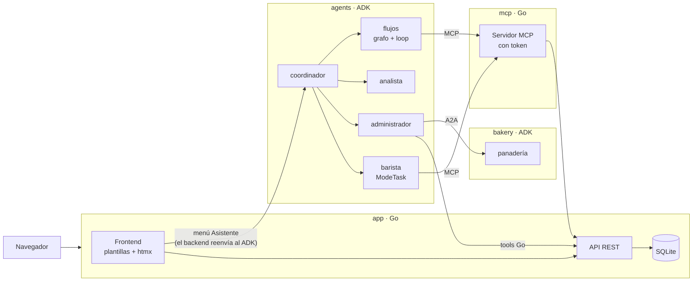

# Proyecto final: sistema de agentes de la cafetería

Objetivo: con todos los conceptos del curso claros, construir una **aplicación de gestión de una cafetería** con su propio frontend, en la que uno de los menús es un **asistente con IA**. El asistente es un sistema de agentes que administra la app, consulta sus datos e ingresa datos. Lo que hace el asistente se ve de inmediato en los demás menús: le pides algo al chat, vas al menú de inventario y ves el cambio.

## Decisiones

| Tema | Decisión |
|---|---|
| Dominio | La cafetería (el hilo de todos los ejemplos del curso) |
| Base de datos | SQLite (un archivo, sin instalar nada) |
| Frontend | Plantillas HTML de Go + htmx: lo genera el mismo servidor Go, sin build de JavaScript |
| Acceso de los agentes a la app | **Ambos**: un MCP propio de la app y tools Go directas, para mostrar la diferencia |
| Autenticación del MCP | Token (bearer), no login con usuario y contraseña |
| Login de usuarios | El de la app. Su identidad se envía a los agentes como `user_id` |
| Despliegue | `docker-compose` publicado en un VPS o en Railway |

## Arquitectura



- **El navegador nunca habla directo con los agentes.** El backend de la app recibe el mensaje del chat y lo reenvía a la API REST del ADK (`/run_sse`) con el usuario logueado como `user_id`. Así no se expone el servidor de agentes.
- **El historial de chats** son las sesiones de ese usuario, que la app lista desde la API del ADK.

### Pantalla de la app

```
┌───────────────────────────────────────────────────────────┐
│  ☕ Cafetería — Hola, Alexys                       Salir  │
├──────────────┬────────────────────────────────────────────┤
│ Inventario   │                                            │
│ Productos    │   (la pantalla del menú elegido)           │
│ Ventas       │                                            │
│ Clientes     │                                            │
│ Reseñas      │                                            │
│ 🤖 Asistente │ ← chat con los agentes + historial         │
└──────────────┴────────────────────────────────────────────┘
```

### Estructura de carpetas

```
cafe_app/
├── go.mod
├── app/      → frontend (plantillas + htmx), API REST, login y SQLite
├── mcp/      → servidor MCP de la app, protegido con token
├── agents/   → el sistema de agentes (ADK)
├── bakery/   → la panadería externa, expuesta por A2A
└── docker-compose.yml
```

## Fases

Cada fase es pequeña, se prueba por sí sola y termina con commit.

| # | Fase | Qué se construye | Conceptos del curso |
|---|---|---|---|
| 1 | **App base** | SQLite con productos, inventario, ventas, clientes y reseñas, más datos de ejemplo. API REST. Frontend con login y los menús de gestión: se pueden registrar ventas y editar inventario a mano | — (la base de todo) |
| 2 | **MCP de la app** | Servidor MCP con tools para consultar (menú, stock, ventas) e ingresar datos (crear venta, dejar reseña), protegido con token | MCP del lado servidor, autenticación por token |
| 3 | **Coordinador + barista** | El coordinador delega; el barista en `ModeTask` recoge el pedido completo y lo crea por MCP. **Se agrega el menú Asistente** a la app y se conecta con los agentes | Delegación, `ModeTask`, MCP cliente |
| 4 | **Administrador** | Tools Go directas: ajusta inventario (confirmación sí/no) y aprueba descuentos que puede modificar | Tools propias, HITL booleano, HITL con modificación, MCP vs tools Go |
| 5 | **Analista** | Reporte del día: ventas, inventario y reseñas analizados en **paralelo**, luego un redactor en **secuencia**. Usa una skill y responde con salida estructurada | Parallel, sequential, skills, `OutputSchema` |
| 6 | **Flujos** | Un grafo clasifica lo que quiere el cliente: pedido → flujo de pedido; combo → **loop** que arma un combo con presupuesto, verificado por una tool Go con los precios reales (corta con `Escalate`); otro caso → ayuda | Grafo, loop |
| 7 | **Usuarios** | Historial de chats por usuario en el menú Asistente (sesiones en SQLite) y memoria a largo plazo ("la semana pasada pediste...") | Sesiones persistentes, memoria a largo plazo |
| 8 | **Reabastecimiento** | Si falta pan, el administrador le pide a la panadería externa por A2A | A2A |
| 9 | **Despliegue** | `docker-compose` con todos los servicios (SQLite en un volumen) y publicación en un VPS o Railway | Docker, despliegue |

### Cómo usa el sistema cada tipo de usuario

| Usuario | Qué hace en el menú Asistente |
|---|---|
| Cliente / cajero | Pide productos, arma combos con presupuesto, deja reseñas |
| Administrador | Ajusta inventario, aprueba descuentos, pide pan a la panadería |
| Dueño | Consulta el reporte del día |

## Lo que queda fuera

| Concepto | Por qué |
|---|---|
| Google Search (tools prebuilt) | No aporta al caso de la cafetería |
| MCP stdio | El MCP de la app es HTTP |
| MCP con login (usuario y contraseña) | Se usa token: más simple de probar y desplegar |
| Workflow dinámico | El grafo y el loop cubren los flujos |
| Claude Code por A2A | Es un caso para desarrolladores, no para la cafetería |
| Callbacks | Se descartaron al inicio del curso |
| Plugins, telemetría, compactación | No cambian lo que hace el sistema |

## Pendientes por verificar

- **Fase 6:** que un `loopagent` funcione como nodo dentro de un grafo (`workflow.NewAgentNode`). Si no funciona, el combo queda como un agente aparte del coordinador.
- **Fase 7:** cómo funciona la memoria a largo plazo en el ADK Go (`memory`, `preloadmemorytool`, `loadmemorytool`) y si tiene un servicio persistente o solo en memoria.
- **Fase 9:** las condiciones actuales del plan gratuito de Railway; si no conviene, un VPS con Docker.
