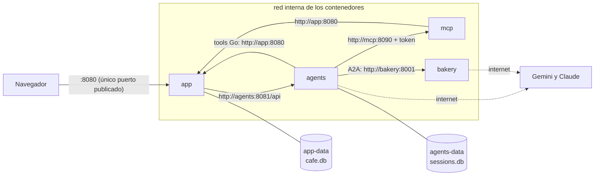

# cafe_app — el proyecto final: la cafetería con agentes

Una app de gestión de una cafetería (ventas, inventario, clientes y reseñas) con un menú **Asistente** atendido por un sistema de agentes del ADK. El plan por fases está en [PLAN.md](PLAN.md); cada carpeta tiene su propio README.

| Carpeta | Qué es | Puerto |
|---|---|---|
| [`app/`](app/README.md) | Frontend (plantillas + htmx), API REST, login y SQLite | 8080 |
| [`mcp/`](mcp/README.md) | Servidor MCP de la app, protegido con token | 8090 |
| [`agents/`](agents/README.md) | El sistema de agentes: coordinador, barista, administrador, reseñas, analista y flujos | 8081 |
| [`bakery/`](bakery/README.md) | La panadería La Espiga, otro negocio, expuesta por A2A | 8001 |

## Despliegue con contenedores (fase 9)

Los cuatro servicios corren con un solo comando, con Docker o con Podman:



```bash
cd cafe_app
cp .env.example .env      # completa los secretos y las claves de los modelos
docker compose up -d      # o: podman compose up -d
```

Abre http://localhost:8080 (usuario `admin` / `admin123`). Para ver los logs: `docker compose logs -f agents`. Para apagar: `docker compose down` (los datos quedan en los volúmenes; `down -v` los borra).

### Cómo está armado

| Decisión | Por qué |
|---|---|
| **Una sola imagen** con los cuatro binarios; cada servicio arranca el suyo con `entrypoint` | Se compila una vez. Con una imagen por servicio, Podman compilaba lo mismo cuatro veces en paralelo y se quedaba sin memoria |
| Imagen final **distroless** (`static`, usuario sin privilegios): 112 MB | Las dos bases SQLite son Go puro, así que se compila sin CGO y no hace falta un sistema operativo. Trae los certificados para llamar a los modelos por HTTPS |
| **Solo la app publica un puerto** | La API del ADK (agentes) y la panadería no tienen autenticación: quedan en la red interna. El MCP exige su token aunque esté adentro |
| **Dos volúmenes**: `app-data` (`cafe.db`) y `agents-data` (`sessions.db`) | Cada servicio es dueño de su base. Las ventas y las conversaciones sobreviven a `down` / `up` |
| Los secretos van en `.env` (no se sube al repo) y el compose **se niega a arrancar** si falta uno (`${VAR:?}`) | Mejor un error claro al inicio que un agente que falla en la primera pregunta |
| `restart: unless-stopped` | Los agentes cargan el MCP al arrancar; si arrancan antes que él, se reinician solos |

### Lo que hubo que cambiar para correr en contenedores

- **`-host 0.0.0.0` en los agentes y la panadería.** El launcher del ADK escucha por defecto solo en `127.0.0.1`: dentro de un contenedor eso lo deja inalcanzable para los demás.
- **La agent card de la panadería.** `remoteagent.NewAgentCardProvider` solo acepta una card cuyas direcciones sean `https` (o `http` en `localhost`), para que nadie intercepte los pedidos. Entre contenedores la panadería es `http://bakery:8001`, así que la rechazaba. `agents/restock.go` usa su propio proveedor, `sameOriginCardProvider`, que mantiene lo importante: la card solo puede apuntar al **mismo origen** que configuramos. Con una panadería real en internet la URL sería `https`.
- **Los nombres de imagen completos** en el `Dockerfile` (`docker.io/library/golang`): Podman no siempre acepta los cortos.
- **La compilación pide memoria.** El paquete `openai-go` (los agentes lo usan para hablar con Claude) es muy grande: con la máquina de Podman en 2 GB el compilador moría (`signal: killed`). El `Dockerfile` compila con `-p 1` y `GOGC=20` para gastar menos memoria, y aun así conviene darle 4 GB a la máquina:

  ```bash
  podman machine stop && podman machine set --memory 4096 && podman machine start
  ```

### ¿Y publicarlo en internet?

El mismo `docker compose up -d` sirve en un **VPS** con Docker o Podman (agregando HTTPS delante de la app, por ejemplo con Caddy).

En **Railway**, según sus condiciones de octubre de 2026, el plan gratuito no alcanza: permite 3 servicios con 0,5 GB cada uno y $1 de crédito al mes, y aquí hay 4. El periodo de prueba ($5 por 30 días) sirve para una demo, pero borra los volúmenes 30 días después de que vence. El plan Hobby ($5 al mes con $5 de consumo incluido) sí alcanza. Railway no ejecuta el compose tal cual: cada servicio se crea aparte con la misma imagen, su comando y sus variables.
