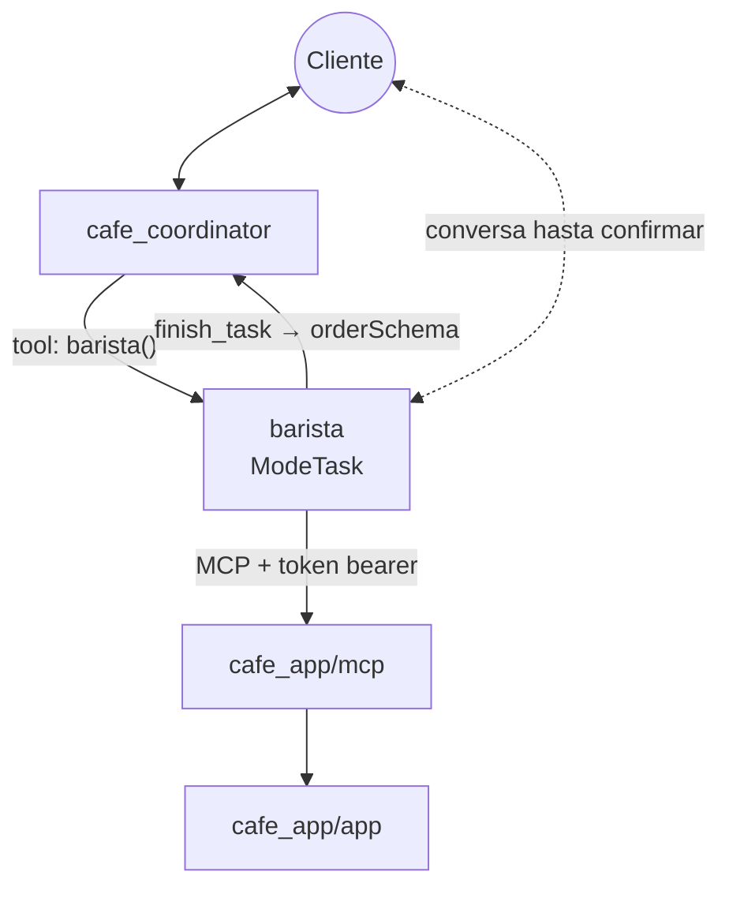
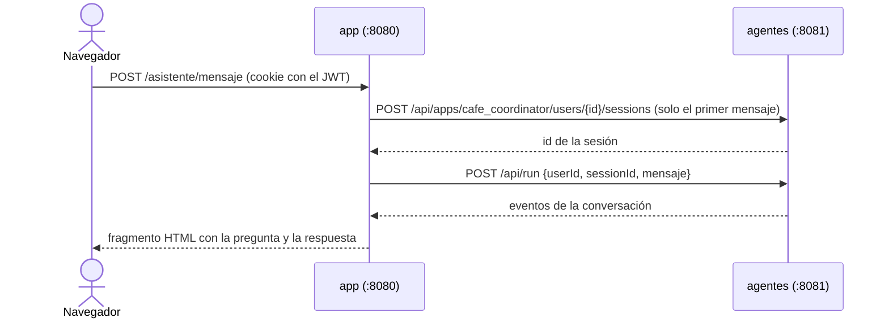

# cafe_app/agents — coordinador + barista (fase 3)

El primer sistema de agentes de la cafetería (ADK). El **coordinador** recibe al cliente y **delega** los pedidos en el **barista**, que corre en `ModeTask`: conversa con el cliente hasta tener el pedido completo, lo registra por **MCP** y devuelve el resultado al coordinador.



Qué usa del curso: delegación (ver `my_multiagent_delegation`), `ModeTask` con `OutputSchema` (ver `my_multiagent_modes`) y un MCP por HTTP con token (ver `my_agent_with_mcp`).

## Cómo trabaja el barista

1. Consulta el menú con `list_menu` (nunca inventa productos ni precios).
2. Pregunta qué falta: productos, cantidades y el nombre del cliente (lo busca en `list_customers`).
3. Repite el pedido con el total y **pide confirmación** antes de usar `create_sale`.
4. Si no hay stock, se lo dice al cliente y ofrece cambiar el pedido.
5. Al terminar llama a `finish_task` con `orderSchema`: número de venta, total y resumen. Ese JSON vuelve al coordinador, que confirma el pedido.

## Ejecutar

Tres procesos, cada uno en su terminal:

```bash
# 1) la app (puerto 8080)
cd cafe_app/app && go run .

# 2) el MCP (puerto 8090)
cd cafe_app/mcp && CAFE_MCP_TOKEN=un-token-largo go run .

# 3) los agentes (puerto 8081)
cd cafe_app/agents
cp .env.example .env     # completa GOOGLE_API_KEY y el mismo CAFE_MCP_TOKEN
set -a; source .env; set +a
go run . web -port 8081 -write-timeout 2m api
```

- `web -port 8081 ... api`: levanta solo la API REST del ADK (sin la interfaz web), bajo `http://localhost:8081/api`. La app la usa para el menú **Asistente**.
- `-write-timeout 2m`: un turno puede llamar varias veces al modelo y al MCP; con los 15 s por defecto la respuesta se cortaría.

Para probar los agentes solos, con la interfaz del ADK: `go run . web -port 8081 webui api`.

## Cómo la app habla con los agentes

El navegador **nunca** llama a los agentes. El backend de la app (`app/agents.go`) recibe el mensaje del chat y lo reenvía a la API del ADK, con el usuario logueado como `user_id`:



La sesión se recuerda en la cookie `cafe_chat`. "Nueva conversación" la borra. Si los agentes no reconocen la sesión (por ejemplo, se reiniciaron), la app abre una nueva y reintenta. Por ahora las sesiones viven en memoria: el historial por usuario llega en la fase 7.

## Prueba sugerida

En el menú **Asistente**:

1. `Hola, quiero 2 cappuccinos y un croissant` → el barista consulta el menú y repite el pedido con el total.
2. `Me llamo Laura Gómez, todo correcto` → registra la venta; en **Ventas** aparece a nombre de `Asistente IA`.
3. Pide 50 panes de queso → el barista explica que no hay stock suficiente.
4. `¿Cuánto es 2+2?` → el coordinador responde que solo ayuda con la cafetería.
