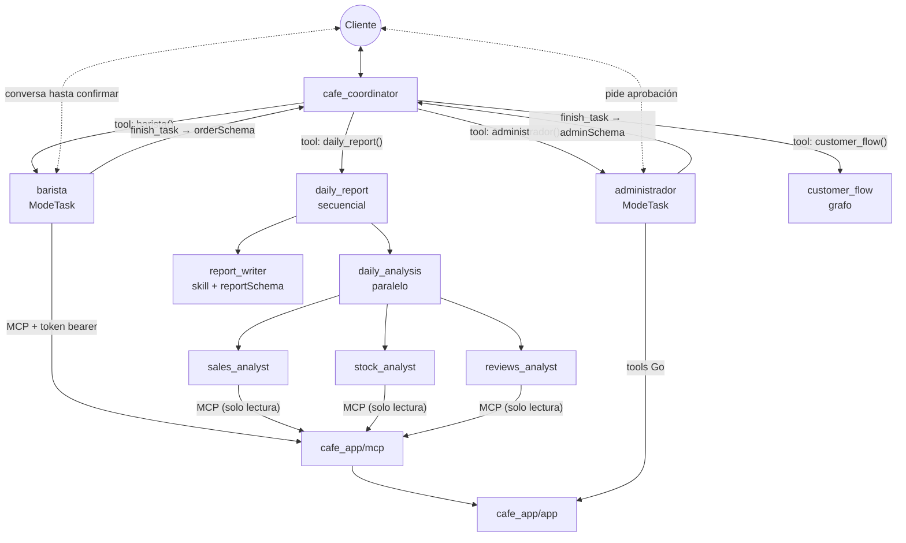
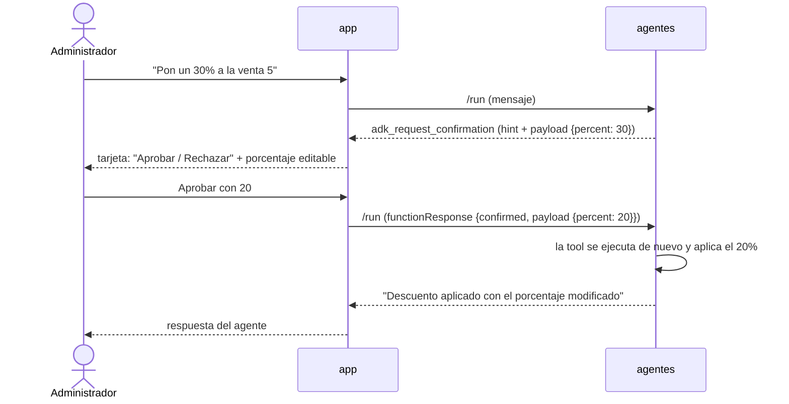
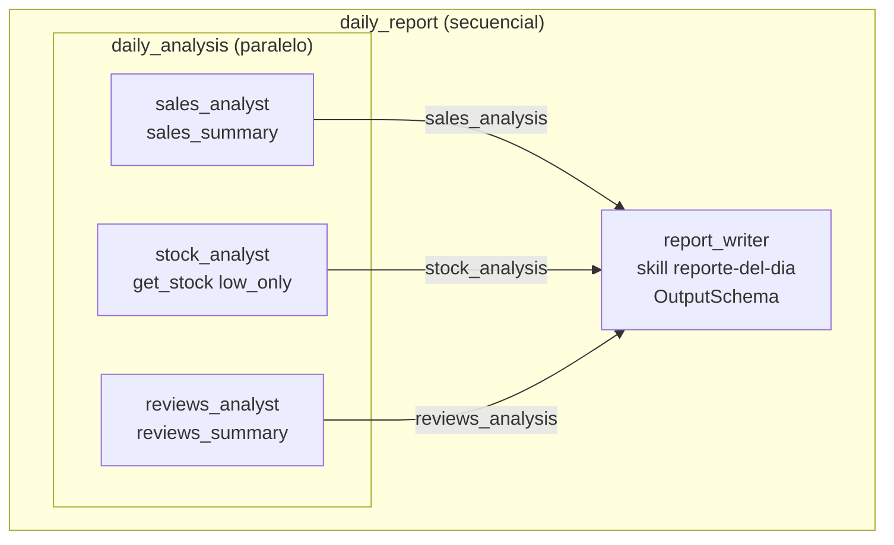
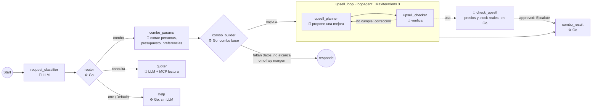
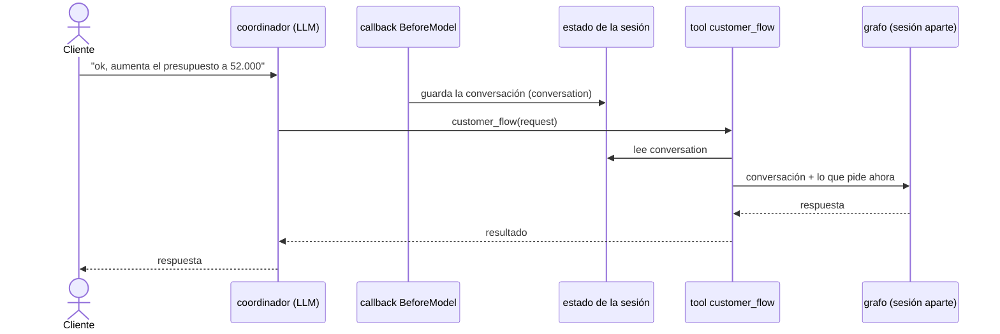
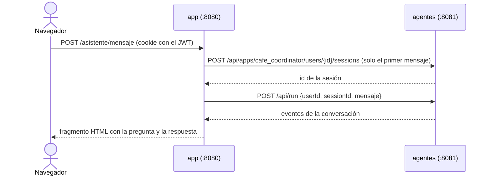

# cafe_app/agents — coordinador, barista, administrador, reseñas, analista y flujos (fases 3 a 7)

El sistema de agentes de la cafetería (ADK). El **coordinador** recibe al usuario y **delega** en dos sub-agentes en `ModeTask` y en un pipeline de análisis:

- el **barista** (fase 3) toma el pedido y lo registra por **MCP**;
- el **administrador** (fase 4) consulta y ajusta el inventario y aplica descuentos con **tools Go**, pidiendo la confirmación de una persona;
- el agente de **reseñas** recoge la opinión del cliente y la guarda;
- el **analista** (fase 5) arma el reporte del día con un workflow **paralelo + secuencial**;
- los **flujos** (fase 6) son un **grafo** que clasifica lo que quiere el cliente y lo manda por su camino, con un **loop** para armar combos.



Qué usa del curso: delegación (ver `my_multiagent_delegation`), `ModeTask` con `OutputSchema` (ver `my_multiagent_modes`) y un MCP por HTTP con token (ver `my_agent_with_mcp`).

## Los modelos

| Agente | Modelo | Por qué |
|---|---|---|
| Coordinador, administrador, analista, flujos | Gemini (`gemini-3.5-flash-lite`) | Tareas acotadas con tools y esquemas |
| **Barista y reseñas** | **Claude Haiku** (`claude-haiku-4-5`, de Anthropic) | Con Gemini flash-lite leía mal el menú ("no tenemos latte") y decidía mal; son los agentes que hablan con el cliente |

El ADK Go no trae un paquete para Anthropic, pero su endpoint es compatible con la Chat Completions API de OpenAI: `models.go` apunta `openaimodel` a `https://api.anthropic.com/v1/` (igual que `my_agent_with_other_models`). Cada agente puede tener su propio modelo, y el nombre del modelo del barista se cambia con `CAFE_BARISTA_MODEL`. Hacen falta `GOOGLE_API_KEY` y `ANTHROPIC_API_KEY`.

Con Haiku el barista es más conversacional (a veces pregunta "¿algo más?" antes de registrar) y gasta más palabras que Gemini; las instrucciones le piden no narrar lo que va a hacer.

## Cómo trabaja el barista

El barista **lee** por MCP (`list_menu` y `get_stock`) y **registra** con una tool Go, `register_sale` (`order.go`), que exige la aprobación del cliente con una tarjeta:

1. Consulta el menú con `list_menu` (nunca inventa productos ni precios).
2. Pregunta qué falta: productos, cantidades y el **nombre** del cliente.
3. Llama a `register_sale`. El **código** (no el modelo):
   - comprueba que el cliente **dijo** ese nombre (o que prefiere no darlo) leyendo la conversación guardada: si no, la tool responde "pregúntaselo" y no aparece ninguna tarjeta;
   - valida el menú y el **stock**, junta los renglones repetidos y **calcula el total**;
   - muestra la tarjeta "¿Registrar este pedido? 5 x Americano, 5 x Sándwich… Cliente: Carlos Pérez. Total: $ 82.000", con Aprobar y Rechazar.
4. Solo si el cliente aprueba se llama a `POST /api/sales`. Si rechaza, no se registra nada.
5. Termina con `finish_task` y `orderSchema`: número de venta, total y resumen (`order_id` 0 si el cliente canceló). Ese JSON vuelve al coordinador.

### Por qué el registro es una tool Go y no el `create_sale` del MCP

Primero la confirmación era una regla del prompt ("confirma antes de registrar") y el modelo la saltó: registró ventas sin que el cliente confirmara. Un prompt no garantiza nada; el código sí. Y solo una tool Go puede pausar al agente con `ctx.RequestConfirmation` (ver la comparación MCP vs. tools Go más abajo). El `create_sale` del MCP sigue existiendo para otros clientes MCP, pero el barista ya no lo ve (`tool.FilterToolset`).

### Lo que aprendimos al armarlo

- **Cuando el cliente pulsa "Rechazar", el ADK ni siquiera vuelve a ejecutar la tool**: el modelo recibe un error `call is rejected`. Si no se le dice qué significa, el barista **reintenta** y pide otra tarjeta. Las instrucciones lo tratan como una cancelación (`order_id` 0).
- **El modelo llamaba a `register_sale` antes de saber el nombre** (usaba "anónimo" por su cuenta). Cada corrección de prompt dejaba otro hueco, así que el nombre se exige en código (`customerSaid`). Para eso el barista también guarda la conversación en el estado (`rememberConversation`): habla con el cliente sin pasar por el coordinador.
- **Cada tarea del barista ve solo su propia conversación.** El nombre que el cliente dio en un pedido era invisible para la tarea del pedido siguiente ("ahora dame 1 capuchino adicional"), y el barista volvía a preguntarlo. Los datos que deben viajar entre tareas se guardan en el **estado de la sesión**, que todas comparten y que se guarda en SQLite: `register_sale` anota `customer_name` y la instrucción del barista lo lee con `{customer_name?}`.
- **Una tarjeta vieja no debe poder aprobarse**: si el agente siguió adelante, la app deja activa solo la última tarjeta pendiente.
- **Los errores de lectura del modelo siguen existiendo** (una vez dijo "no tenemos brownie" con 18 en stock), pero ya no pueden dañar datos: la tarjeta muestra los productos y el total reales.

### Qué pasa si piden algo que no trata el barista

Mientras el barista tiene un pedido abierto, **todos los mensajes le llegan a él**, aunque el cliente pida otra cosa (por ejemplo, "agrega la reseña: estuvo muy mal" o "cotízame un combo para 2 con $30.000"). Si el barista lo atiende por su cuenta, inventa: una vez armó cinco combos con un producto agotado y sumas mal hechas. Lo que hace:

1. **La primera vez**, lo aplaza con cortesía: "primero terminemos tu pedido, ¿lo continuamos o lo cancelamos?".
2. **Si el cliente insiste**, termina su tarea (`finish_task` con `order_id` 0) y le devuelve al coordinador, en `pending_request`, lo que pidió. El coordinador lo atiende como si el cliente lo acabara de pedir: para una reseña, llama al agente `resenas`. El pedido a medias se pierde.

La cuenta de la insistencia la lleva el **código**: el barista llama a la tool `off_topic` cada vez que el cliente pide algo ajeno, y ella le responde `aplazar` o `terminar` según un contador guardado en el estado. Cuando esa decisión la tomaba el modelo ("si insiste, termina"), aplazaba una y otra vez sin terminar nunca. Y para que no se pierda el comentario del cliente, `off_topic` guarda lo primero que pidió y lo devuelve al terminar.

## Las reseñas

El agente `resenas` (`ModeTask`, con Claude Haiku):
- Pide la **calificación de 1 a 5** si no la dio; nunca la inventa ni la deduce del comentario.
- Llama a `save_review` (`review.go`), una tool Go que valida en código (calificación de 1 a 5, producto existente) y **guarda directo**, sin tarjeta de aprobación: el cliente ya dijo qué opina y cuánto le da, y una reseña no mueve dinero ni inventario. (Al principio tenía tarjeta, por uniformidad con las ventas; sobraba.)
- Usa el nombre del cliente si ya se conoce de un pedido (`customer_name` del estado).

## El administrador: tools Go con aprobación humana (fase 4)

Sus tools (`admin.go`) son funciones Go que llaman a la API de la app. Las que **cambian datos** pausan al agente con `ctx.RequestConfirmation` hasta que una persona responde:

| Tool | Confirmación | Qué decide la persona |
|---|---|---|
| `get_inventory` | ninguna (solo lee) | — |
| `adjust_inventory` | **booleana** (sí/no) | Aprobar o rechazar el cambio de stock. El aviso dice "de 3 a 43 unidades" |
| `approve_discount` | **con modificación** | Aprobar, rechazar o **cambiar el porcentaje** (1 a 50). La app valida el rango y que la venta no tenga ya un descuento |

La tool se ejecuta dos veces: la primera pide la confirmación (`ToolConfirmation()` es `nil`) y el ADK pausa; la segunda, ya con la respuesta, aplica el cambio o lo descarta.

### MCP vs. tools Go

| | Tools MCP (lecturas del barista, flujos, analista) | Tools Go (`register_sale`, administrador) |
|---|---|---|
| Dónde vive la lógica | En otro proceso (`cafe_app/mcp`), con token bearer | En el mismo proceso del agente |
| Para qué sirve | Que **cualquier** cliente MCP use la app | Lógica propia del agente: validar, calcular, pedir aprobación |
| Confirmación humana | No puede | `ctx.RequestConfirmation`: necesita el contexto del agente |
| Cómo llega a los datos | Cliente de la API con el usuario `asistente` | El mismo cliente (`internal/appclient`) |

Una tool MCP vive fuera del agente, así que no tiene `agent.Context` y no puede pausar la ejecución para pedir una aprobación. Por eso todo lo que **cambia datos y requiere una persona** va como tool Go: ajustar inventario, aplicar descuentos y registrar ventas.

### Cómo se atasca una conversación (y cómo se evita)

Un sub-agente en `ModeTask` conserva la conversación hasta que termina con `finish_task`. Si la tarea queda abierta o falla a medias, **cada mensaje siguiente vuelve a entrar en ella**. Pasó así:

1. Preguntaron "¿en cuánto me quedó la factura?" y el coordinador se lo pasó al administrador, que **no tenía ninguna tool para consultar una venta**.
2. Sin tool, el modelo llamó a `transfer_to_agent` para devolver la pregunta. Una tarea no puede transferir, y el ADK falló con `workflow: RunNode called outside a dynamic node`.
3. La tarea quedó abierta: todos los mensajes siguientes fallaban igual, y el chat quedó atascado en "error interno" hasta abrir una conversación nueva.

Lo que se hizo:
- **Darle la tool que faltaba** (`get_sale`) y decirle al coordinador que las consultas de ventas van al administrador.
- **Prohibir la transferencia** en las tareas (`DisallowTransferToParent` y `DisallowTransferToPeers`): el modelo ni la ve.
- **Terminar siempre con `finish_task`**, también en las consultas, con la respuesta completa en el resumen. Si responde con texto suelto, la tarea queda abierta. Y si no puede hacer algo, termina con `sin_cambios` y lo explica.
- **La página explica qué hacer** cuando los agentes fallan ("pulsa Nueva conversación") y distingue una saturación del proveedor del modelo (`503 UNAVAILABLE`), donde basta con reintentar.

### Cómo se contesta una confirmación

Cuando el agente queda esperando, la API del ADK devuelve como último evento un `functionCall` llamado `adk_request_confirmation` (con el `hint` y el `payload`). Para reanudarlo se envía un `functionResponse` con el mismo `id`:

```json
{"functionResponse": {"id": "adk-…", "name": "adk_request_confirmation",
  "response": {"confirmed": true, "payload": {"percent": 20}}}}
```

La app lo muestra como una **tarjeta** en el chat (Aprobar / Rechazar y los campos del payload editables) y, al decidir la persona, envía esa respuesta. Funciona aunque el administrador corra dentro de una tarea del coordinador.



> Por ahora cualquier usuario del chat puede aprobar sus propias solicitudes; el control por roles no forma parte de las fases del curso.

## El analista: reporte del día (fase 5)

`analyst.go` arma un pipeline que el coordinador usa como una **tool** (`agenttool`):



| Pieza | Concepto del curso | Qué hace aquí |
|---|---|---|
| `daily_analysis` | **Paralelo** | Los tres especialistas consultan al mismo tiempo; cada uno ve **solo** sus tools de solo lectura (`tool.FilterToolset`) |
| `OutputKey` | Estado compartido | Cada especialista deja su resumen en `sales_analysis`, `stock_analysis` o `reviews_analysis` |
| `daily_report` | **Secuencial** | Primero el análisis en paralelo y, cuando terminan los tres, el redactor |
| `report_writer` | **Skill** | Carga `skills/reporte-del-dia` (criterios del reporte: alertas, tono, recomendaciones); las skills viajan embebidas en el binario (`go:embed`) |
| `reportSchema` | **Salida estructurada** | El redactor responde un JSON con `headline`, `sales_summary`, `stock_alerts`, `review_summary` y `recommendations` |
| `InstructionProvider` | Instrucción dinámica | El modelo no sabe qué día es: cada ejecución inserta la fecha de hoy para que consulten solo las ventas y reseñas de ese día |

El coordinador recibe ese JSON como resultado de la tool y lo presenta en texto plano.

### Que el reporte no mienta

Dos defectos reales que se descubrieron al probarlo con datos de verdad:

- **Las cifras las calcula el código, no el modelo.** Los especialistas leían `list_sales` y sumaban los totales "a ojo". Resultado: la tool devolvía por defecto solo las **últimas 10 ventas** (el reporte decía 10 cuando eran 15), y además la suma salía distinta en cada corrida ($243.225 una vez, $253.225 otra; el real era $331.125). Ahora el MCP tiene `sales_summary` y `reviews_summary`, que calculan cantidad, total, ventas con descuento, productos más vendidos y promedio de calificaciones, y los especialistas solo las repiten. Con `get_stock` en `low_only` el inventario también llega ya filtrado.
- **El reporte no recibe texto del coordinador.** Antes se exponía con `agenttool`, que le pasaba al pipeline lo que dijera el cliente: "agrega la reseña: estuvo muy mal" se coló y el reporte afirmó que existía esa reseña. Ahora es una tool **sin parámetros** (`fixedInputTool`) que siempre arranca con la misma orden, "Genera el reporte del día de hoy".

## Los flujos: grafo + loop (fase 6)

`flows.go` y `combo.go` arman un grafo que el coordinador usa como tool (`customer_flow`). El **código** decide el camino y hace las cuentas; los modelos entienden la petición y proponen ideas:



| Camino | Qué hace |
|---|---|
| `combo` | Un LLM extrae personas, presupuesto y preferencias de **la conversación**. `combo_builder` (Go) **calcula** el combo base y decide; si hay margen, el loop busca una mejora |
| `consulta` | Precios, disponibilidad o menú: un LLM con `list_menu` y `get_stock` (solo lectura). No registra ventas |
| `otro` | Un texto fijo de ayuda, sin LLM |

Un pedido en firme **no** pasa por el grafo: sigue con el barista (`ModeTask`), porque pedir exige una conversación de ida y vuelta y un grafo recorre sus nodos una sola vez por mensaje.

### El combo: el código lo calcula, el loop sugiere una mejora

1. **Combo base (código).** Un combo lleva, por persona, una bebida y un alimento (panadería, comida o postres; si el cliente tiene preferencias, solo de esas categorías). `combo_builder` toma las bebidas y los alimentos **más baratos con stock**: el combo más simple y predecible. Es un cálculo, no hace falta IA:
   - si faltan las personas o el presupuesto, se los pide al cliente;
   - si ni el combo más barato cabe, responde **al instante** con el mínimo exacto ("con $41.000 no alcanza; lo más económico es… $46.000, te faltan $5.000");
   - si no queda margen ni para la mejora más barata posible, ofrece solo el combo base.
2. **Mejora (loop).** Si hay margen, `upsell_loop` busca **una** mejora atractiva: cambiar productos por otros mejores o agregar algo para compartir. Proponerla es creativo (lo hace un modelo); verificarla es un cálculo: `check_upsell` (Go) revisa el presupuesto, el stock, una bebida y un alimento por persona, las preferencias y que **de verdad cueste más** que el combo base. Las personas, el presupuesto y el combo base los lee del estado, no de lo que diga el modelo. Si cumple, ella misma detiene el bucle con `ctx.Actions().Escalate = true`.
3. **Respuesta (código).** `combo_result` muestra el combo base y, si el loop encontró una mejora, la opción mejorada para que el cliente elija.

| Caso | Llamadas al modelo | Tiempo (con `gemini-3.5-flash`) |
|---|---|---|
| No alcanza (4 personas, $41.000) | 4 | 8 s |
| Justo, sin margen (4 personas, $46.000) | 4 | 8 s |
| Con margen: base + mejora (4 personas, $60.000) | 8 | 15 s |

### Por qué se rediseñó

La primera versión copiaba `my_workflow_loop`: un modelo **proponía** el combo "a ojo" y el código solo lo **revisaba**, en bucle. Con datos reales eso estaba mal planteado:
- **El código ya tenía todo para calcularlo** (precios, stock, personas, presupuesto y la regla de bebida + alimento). Delegarle el cálculo a un modelo lo hacía lento, impredecible y a veces incorrecto.
- **Un combo imposible tardaba hasta 33 s** (15 a 17 llamadas): el bucle daba todas sus vueltas antes de rendirse, en vez de saber de entrada cuál era el mínimo.
- **El modelo cambiaba las reglas para que cuadrara**: pidieron 4 personas con $45.000 (imposible) y el planificador bajó las personas a 3, y se aprobó.

La lección: usa el modelo para lo que el código no puede hacer (entender la petición, proponer ideas) y el código para todo lo que se puede calcular. El loop sigue en el proyecto, pero donde aporta: buscar una sugerencia de venta que el código no sabría "inventar".

### Lo que aprendimos al armarlo

- **Un `loopagent` funciona como nodo de un grafo** (`workflow.NewAgentNode`), igual que un secuencial o un paralelo.
- **Un agente compuesto no entrega su texto como salida del nodo**: el nodo que sigue al bucle recibe la entrada vacía. Por eso `combo_result` lee el estado y no su entrada.
- **Un nodo Go que cierra el grafo debe emitir su mensaje** (`say`, con `NewEmittingFunctionNode`): quien corre el grafo toma el texto del último evento con contenido, no la salida (`Event.Output`) de un nodo Go.
- **Un agente con `OutputSchema` entrega su salida como objeto**, no como texto JSON: el nodo Go que la recibe debe aceptar las dos formas (`decodeNodeInput`).
- **Verificar en código no basta si los datos que se verifican los dicta el modelo**: las personas y el presupuesto viven en el estado, no en los parámetros de la tool.
- Las claves del combo llevan el prefijo `temp:` (`temp:combo_params`, `temp:combo_base`, `temp:upsell_check`): solo sirven mientras se arma ese combo y el ADK las descarta al terminar el turno, así que nunca se confunden con las de un combo anterior (ver [los alcances del estado](#los-alcances-del-estado)).

## La memoria

La memoria es lo primero que se rompe en un chat de agentes, así que conviene entenderla por niveles:

| Nivel | Qué es | Dónde vive | Estado |
|---|---|---|---|
| **1. Conversación** | Lo que se dijo en este chat | La **sesión** del ADK, en SQLite (`sessions.db`) | ✅ Sobrevive a reiniciar los agentes; la app la muestra al recargar el chat |
| **2. Contexto de los flujos y las tareas** | Que un flujo o una tarea sepa de qué se venía hablando y quién es el cliente | El estado de la sesión (`conversation`, `customer_name`) | ✅ La conversación la guarda un callback `BeforeModel`; el nombre, `register_sale` |
| **3. Entre conversaciones** | Lo que el asistente recuerda del usuario o de la cafetería en un chat nuevo | El estado con prefijo `user:` (`user:preferencias`) y `app:` (`app:avisos`) | ✅ Fase 7 |

### Por qué los flujos no veían la conversación

Los sub-agentes en `ModeTask` (barista, administrador) corren **dentro de la misma sesión**, así que ven todo el historial. Pero un agente envuelto como tool (`agenttool`: el reporte y los flujos) corre en una **sesión nueva y vacía**: solo sabe lo que el LLM del coordinador le reenvíe en `request`. Un mensaje como "ok, aumenta el presupuesto a 52.000" llegaba sin saber de qué se hablaba, y el flujo respondía cosas sin sentido.

Intentar leer la conversación desde la tool no funciona: el contexto de una tool **no soporta `Session()`** (devuelve `nil`). La salida es un callback del coordinador:



`conversation.go` guarda el texto de la conversación (sin llamadas a tools ni pensamientos) y `conversationTool` se la entrega al grafo junto con lo que pide ahora el cliente. Los callbacks del proyecto son solo dos, y cada uno hace algo que de otra forma no se puede: este y el que le pone título a la conversación (ver abajo).

### Persistencia

El coordinador corre con el servicio de sesiones en base de datos (`session/database` con SQLite, como en `my_agent_with_sessions_db`): `CAFE_SESSIONS_DB` (por defecto `sessions.db`). La app guarda el id de la conversación en la cookie `cafe_chat`; al abrir el menú Asistente pide la sesión a la API del ADK y dibuja los mensajes, incluida una aprobación que haya quedado pendiente.

### La lista de conversaciones (fase 7)

El menú Asistente lista las conversaciones del usuario con `GET /api/apps/cafe_coordinator/users/{id}/sessions`. Ese listado trae el **estado** de cada sesión, pero no sus mensajes, así que el título se guarda en el estado: el callback `BeforeAgent` del coordinador, `titleConversation` (`memory.go`), anota el primer mensaje del usuario en la clave `title`. Las conversaciones anteriores a la fase 7 no tienen título y no se listan.

Para abrir una conversación, la app comprueba que esté en la lista **de ese usuario** antes de guardarla en la cookie: nadie abre la conversación de otro aunque conozca su id.

### Los alcances del estado

El estado de la sesión es un mapa clave → valor, y **el prefijo de la clave decide quién la ve y cuánto dura**. Nombres como `customer_name` o `upsell_feedback` no tienen nada especial: los elegimos nosotros. Lo que cambia su alcance es el prefijo.

| Prefijo | Quién la ve | Cuánto dura | En la cafetería |
|---|---|---|---|
| *(ninguno)* | Solo esta conversación | Lo que dure la conversación (se guarda en SQLite) | `customer_name`, `conversation`, `title`, el contador de `off_topic` |
| `user:` | Todas las conversaciones del **mismo usuario** (quien inició sesión en la app) | Siempre | `user:preferencias`: "me llamo Juancho, prefiero respuestas cortas" |
| `app:` | **Todos** los usuarios y todas sus conversaciones | Siempre | `app:avisos`: "hoy no hay pan de queso" |
| `temp:` | Solo el turno en curso | Se descarta al terminar la respuesta; nunca se guarda | `temp:combo_params` y las demás claves del combo |

```
app:   ┌──────────────── la cafetería (todos) ────────────────┐
user:  │ ┌──────── Juan (cajero) ────────┐ ┌── Ana (admin) ──┐ │
sesión │ │ ┌ conversación 1 ┐ ┌ conv 2 ┐ │ │ ┌ conv 1 ┐      │ │
temp:  │ │ │ [turno][turno] │ │ [turno]│ │ │ │ [turno]│      │ │
```

En la cafetería:

- **`user:preferencias`, la memoria del usuario.** Si el usuario dice "recuerda que me llamo Juancho", el coordinador llama a `save_preferences`. En una **conversación nueva** el asistente ya lo sabe: su instrucción lo lee con `{user:preferencias?}`.
- **`app:avisos`, la memoria de toda la cafetería.** "Avisa a todo el equipo que hoy no hay pan de queso" va al administrador, que llama a `save_notices`. Cualquier usuario, en cualquier conversación, recibe el aviso en la instrucción del coordinador y del barista (`{app:avisos?}`). Como no hay control de roles, cualquiera puede publicar un aviso.
- Las dos tools **reemplazan el texto completo** (no agregan al final): así el modelo también puede corregir u olvidar algo ("ya no me llames Juancho"). El texto tiene un máximo de 600 caracteres porque va en la instrucción de **cada** llamada al modelo.
- En la base, el ADK guarda cada alcance en su propia tabla: `user_states` y `app_states` (sin el prefijo), además de `sessions`.

Cuidado al elegir el prefijo: `user:` es de **quien inició sesión**, no del cliente de la cafetería. El cajero atiende a muchos clientes, por eso `customer_name` es de la conversación: con `user:customer_name`, el siguiente cliente heredaría el nombre del anterior.

### ¿Y el servicio de memoria del ADK?

El ADK tiene además un **servicio de memoria** (`memory.Service`, con las tools `load_memory` y `preload_memory`) para **buscar en lo que se habló** en conversaciones anteriores. No es lo mismo que la persistencia:

| | Persistencia (sesiones) | Servicio de memoria |
|---|---|---|
| Qué guarda | La conversación completa | Fragmentos que se pueden buscar |
| Qué ve el modelo | La conversación actual, siempre | Lo que devuelva una búsqueda |
| Cómo se llena | Sola, en cada evento | Alguien debe llamar a `AddSessionToMemory` (el ADK no lo hace solo) |

No lo usamos porque en Go solo hay dos implementaciones: `memory.InMemoryService`, que vive en la RAM, crece con cada conversación y se vacía al reiniciar, y la de **Vertex AI** (Memory Bank), que exige Google Cloud. Para la cafetería alcanza con el estado `user:` y `app:`: ocupa un tamaño fijo, ya se guarda en SQLite y lo escribe una tool que valida. El servicio de memoria haría falta para preguntas como "¿qué combo me armaste la semana pasada?"; en ese caso habría que implementar `memory.Service` sobre una base de datos, o usar Vertex AI.

## Si aparece "se alcanzó el límite de peticiones por minuto"

Google limita las peticiones por minuto **por proyecto y por modelo**. Con un proyecto **sin facturación** (plan gratuito) el límite es de 15 por minuto en los modelos `flash-lite` y de 5 en los `flash`, y este sistema lo agota rápido: un reporte del día hace unas 11 llamadas al modelo, un combo unas 8 y una consulta de precio unas 5.

Si ves ese aviso, revisa primero **qué clave tiene `agents/.env`**: el error de Google trae un `quotaId` que termina en `-FreeTier` cuando el proyecto de esa clave no tiene facturación. En https://aistudio.google.com/apikey cada clave muestra su proyecto y su plan ("Billing Tier"). Con una clave de un proyecto con facturación, 35 llamadas en 25 segundos (un reporte, un combo, otro reporte y una consulta seguidos) no dieron ningún error.

Para ver cuántas llamadas hace cada acción, lanza los agentes con `CAFE_LOG_MODEL_CALLS=1`: cada llamada a Gemini queda en el log (sin la clave ni el contenido).

## Ejecutar

Tres procesos, cada uno en su terminal:

```bash
# 1) la app (puerto 8080)
cd cafe_app/app && go run .

# 2) el MCP (puerto 8090)
cd cafe_app/mcp && CAFE_MCP_TOKEN=un-token-largo go run .

# 3) los agentes (puerto 8081; también llaman a la app: CAFE_APP_URL, CAFE_APP_USER y CAFE_APP_PASSWORD)
cd cafe_app/agents
cp .env.example .env     # completa GOOGLE_API_KEY, ANTHROPIC_API_KEY (el barista) y el mismo CAFE_MCP_TOKEN
set -a; source .env; set +a
go run . web -port 8081 -write-timeout 2m api   # las conversaciones quedan en sessions.db
```

- `web -port 8081 ... api`: levanta solo la API REST del ADK (sin la interfaz web), bajo `http://localhost:8081/api`. La app la usa para el menú **Asistente**.
- `-write-timeout 2m`: un turno puede llamar varias veces al modelo y al MCP; con los 15 s por defecto la respuesta se cortaría.

Para probar los agentes solos, con la interfaz del ADK: `go run . web -port 8081 webui api`.

## Cómo la app habla con los agentes

El navegador **nunca** llama a los agentes. El backend de la app (`app/agents.go`) recibe el mensaje del chat y lo reenvía a la API del ADK, con el usuario logueado como `user_id`:



La conversación abierta se recuerda en la cookie `cafe_chat`. "Nueva conversación" la borra, y la lista de conversaciones permite volver a una anterior. Si los agentes no reconocen la sesión, la app abre una nueva y reintenta.

## Prueba sugerida

En el menú **Asistente**:

1. `Hola, quiero 2 cappuccinos y un croissant` → el barista consulta el menú y te pregunta el nombre (no aparece ninguna tarjeta todavía).
2. `Me llamo Laura Gómez` → aparece la tarjeta "¿Registrar este pedido?" con los productos y el total. **Aprobar** registra la venta (en **Ventas** aparece a nombre de `Asistente IA`); **Rechazar** no registra nada.
3. Pide 50 panes de queso → el barista explica que no hay stock suficiente.
4. `¿Cuánto es 2+2?` → el coordinador responde que solo ayuda con la cafetería.
5. `Llegaron 40 panes de queso, actualiza el inventario` → aparece la tarjeta "¿Cambiar el inventario de Pan de queso de 3 a 43 unidades?". Aprueba y revisa **Inventario**; con "Rechazar" no cambia nada.
7. `Aplica un 30% de descuento a la venta 5, cliente frecuente` → en la tarjeta cambia el porcentaje a 20 y aprueba. En **Ventas** la venta 5 muestra `−20%`.
8. `Dame el reporte del día` → tarda unos 8 segundos y muestra titular, ventas, alertas de inventario, reseñas y recomendaciones. Con el pan de queso en 3 (mínimo 10), debe aparecer como alerta crítica.
8b. `Agrega la reseña: estuvo muy mal` → te pregunta la calificación y la guarda (míralo en **Reseñas**).
8c. Empieza un pedido (`Quiero un latte`), luego pide `agrega la reseña: estuvo muy mal` → el barista lo aplaza con cortesía. Insiste (`no, quiero dejar la reseña ahora`) → el barista termina su turno y pasa a reseñas.
9. `Quiero un combo para 4 personas con 60.000` → el combo base (el más económico) y una opción mejorada que cabe en el presupuesto.
10. `Un combo para 4 personas con 41.000` → al instante: no alcanza, el mínimo es $46.000.
11. `¿Cuánto cuestan 3 lattes y 2 brownies? ¿Hay pan de queso?` → cotiza con precios reales, sin registrar nada.
12. `Necesito ayuda, no sé qué hacer` → el texto fijo de ayuda (camino `otro`).
13. **Memoria**: `Cotízame un combo para 5 personas con 52.000` → arma el combo. Luego `¿y si fueran 6 personas con el mismo presupuesto?` → recuerda los $52.000. Reinicia los agentes, recarga el chat y sigue la conversación: no se pierde nada.
14. **Datos faltantes**: `Quiero un combo para 5 personas` (sin presupuesto) → te pregunta cuál es tu presupuesto, no lo inventa.
15. **Lista de conversaciones**: pulsa «Nueva conversación», escribe algo y abre la conversación anterior desde la lista de la izquierda: el chat muestra lo conversado y puedes seguir.
16. **Memoria del usuario (`user:`)**: `Recuerda que me llamo Juancho y que prefiero respuestas cortas`. Abre una conversación nueva y pregunta `¿cómo me llamo?` → "Juancho". Con otro usuario (por ejemplo, admin) no lo sabe.
17. **Memoria de la cafetería (`app:`)**: como admin, `Avisa a todo el equipo que hoy no hay pan de queso`. Entra como cajero, en una conversación nueva: `¿hay algún aviso para hoy?` → el aviso. Para quitarlo: `quita el aviso del pan de queso`.
