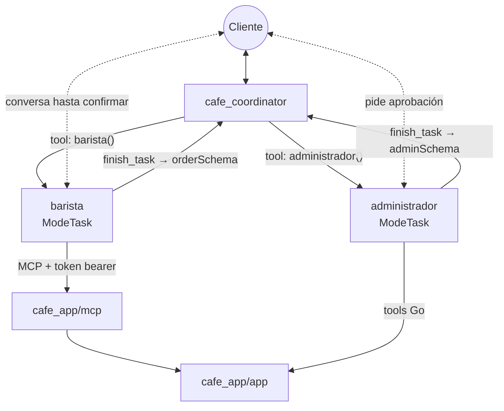
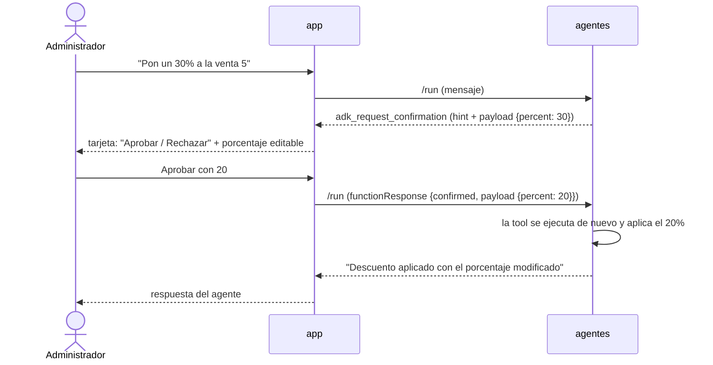
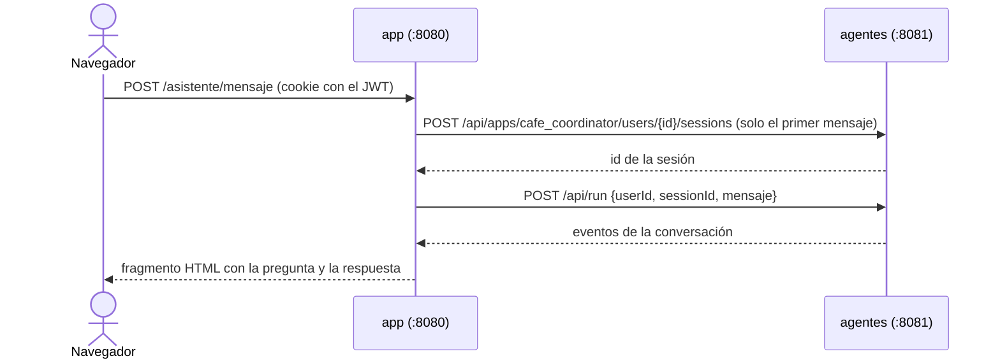

# cafe_app/agents — coordinador, barista y administrador (fases 3 y 4)

El sistema de agentes de la cafetería (ADK). El **coordinador** recibe al usuario y **delega** en dos sub-agentes, ambos en `ModeTask`:

- el **barista** (fase 3) toma el pedido y lo registra por **MCP**;
- el **administrador** (fase 4) consulta y ajusta el inventario y aplica descuentos con **tools Go**, pidiendo la confirmación de una persona.



Qué usa del curso: delegación (ver `my_multiagent_delegation`), `ModeTask` con `OutputSchema` (ver `my_multiagent_modes`) y un MCP por HTTP con token (ver `my_agent_with_mcp`).

## Cómo trabaja el barista

1. Consulta el menú con `list_menu` (nunca inventa productos ni precios).
2. Pregunta qué falta: productos, cantidades y el nombre del cliente (lo busca en `list_customers`).
3. Repite el pedido con el total y **pide confirmación** antes de usar `create_sale`.
4. Si no hay stock, se lo dice al cliente y ofrece cambiar el pedido.
5. Al terminar llama a `finish_task` con `orderSchema`: número de venta, total y resumen. Ese JSON vuelve al coordinador, que confirma el pedido.

## El administrador: tools Go con aprobación humana (fase 4)

Sus tools (`admin.go`) son funciones Go que llaman a la API de la app. Las que **cambian datos** pausan al agente con `ctx.RequestConfirmation` hasta que una persona responde:

| Tool | Confirmación | Qué decide la persona |
|---|---|---|
| `get_inventory` | ninguna (solo lee) | — |
| `adjust_inventory` | **booleana** (sí/no) | Aprobar o rechazar el cambio de stock. El aviso dice "de 3 a 43 unidades" |
| `approve_discount` | **con modificación** | Aprobar, rechazar o **cambiar el porcentaje** (1 a 50). La app valida el rango y que la venta no tenga ya un descuento |

La tool se ejecuta dos veces: la primera pide la confirmación (`ToolConfirmation()` es `nil`) y el ADK pausa; la segunda, ya con la respuesta, aplica el cambio o lo descarta.

### MCP vs. tools Go

| | Barista (MCP) | Administrador (tools Go) |
|---|---|---|
| Dónde vive la lógica | En otro proceso (`cafe_app/mcp`), con token bearer | En el mismo proceso del agente |
| Para qué sirve | Que **cualquier** cliente MCP use la app | Lógica propia del agente, como pedir aprobación |
| Confirmación humana | No la necesita (crear una venta es el flujo normal) | `ctx.RequestConfirmation`: necesita el contexto del agente |
| Cómo llega a los datos | Cliente de la API con el usuario `asistente` | El mismo cliente (`internal/appclient`) |

Una tool MCP vive fuera del agente, así que no tiene `agent.Context` y no puede pausar la ejecución para pedir una aprobación. Por eso lo que requiere HITL va como tool Go.

### Cómo se contesta una confirmación

Cuando el agente queda esperando, la API del ADK devuelve como último evento un `functionCall` llamado `adk_request_confirmation` (con el `hint` y el `payload`). Para reanudarlo se envía un `functionResponse` con el mismo `id`:

```json
{"functionResponse": {"id": "adk-…", "name": "adk_request_confirmation",
  "response": {"confirmed": true, "payload": {"percent": 20}}}}
```

La app lo muestra como una **tarjeta** en el chat (Aprobar / Rechazar y los campos del payload editables) y, al decidir la persona, envía esa respuesta. Funciona aunque el administrador corra dentro de una tarea del coordinador.



> Por ahora cualquier usuario del chat puede aprobar sus propias solicitudes; el control por roles no forma parte de las fases del curso.

## Ejecutar

Tres procesos, cada uno en su terminal:

```bash
# 1) la app (puerto 8080)
cd cafe_app/app && go run .

# 2) el MCP (puerto 8090)
cd cafe_app/mcp && CAFE_MCP_TOKEN=un-token-largo go run .

# 3) los agentes (puerto 8081; también llaman a la app: CAFE_APP_URL, CAFE_APP_USER y CAFE_APP_PASSWORD)
cd cafe_app/agents
cp .env.example .env     # completa GOOGLE_API_KEY y el mismo CAFE_MCP_TOKEN
set -a; source .env; set +a
go run . web -port 8081 -write-timeout 2m api
```

- `web -port 8081 ... api`: levanta solo la API REST del ADK (sin la interfaz web), bajo `http://localhost:8081/api`. La app la usa para el menú **Asistente**.
- `-write-timeout 2m`: un turno puede llamar varias veces al modelo y al MCP; con los 15 s por defecto la respuesta se cortaría.

Para probar los agentes solos, con la interfaz del ADK: `go run . web -port 8081 webui api`.

## Cómo la app habla con los agentes

El navegador **nunca** llama a los agentes. El backend de la app (`app/agents.go`) recibe el mensaje del chat y lo reenvía a la API del ADK, con el usuario logueado como `user_id`:



La sesión se recuerda en la cookie `cafe_chat`. "Nueva conversación" la borra. Si los agentes no reconocen la sesión (por ejemplo, se reiniciaron), la app abre una nueva y reintenta. Por ahora las sesiones viven en memoria: el historial por usuario llega en la fase 7.

## Prueba sugerida

En el menú **Asistente**:

1. `Hola, quiero 2 cappuccinos y un croissant` → el barista consulta el menú y repite el pedido con el total.
2. `Me llamo Laura Gómez, todo correcto` → registra la venta; en **Ventas** aparece a nombre de `Asistente IA`.
3. Pide 50 panes de queso → el barista explica que no hay stock suficiente.
4. `¿Cuánto es 2+2?` → el coordinador responde que solo ayuda con la cafetería.
5. `Llegaron 40 panes de queso, actualiza el inventario` → aparece la tarjeta "¿Cambiar el inventario de Pan de queso de 3 a 43 unidades?". Aprueba y revisa **Inventario**; con "Rechazar" no cambia nada.
6. `Aplica un 30% de descuento a la venta 5, cliente frecuente` → en la tarjeta cambia el porcentaje a 20 y aprueba. En **Ventas** la venta 5 muestra `−20%`.
