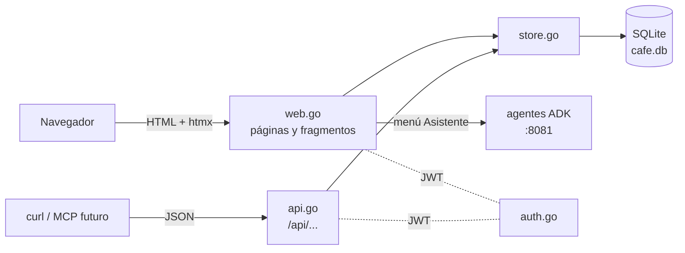

# cafe_app/app — app base de la cafetería (fase 1)

La aplicación que luego usarán los agentes: SQLite, una API REST en JSON y un frontend con plantillas de Go + htmx. Todavía **no hay agentes**; esta fase se prueba a mano desde el navegador.



La API y el frontend comparten `store.go`: una sola implementación de las reglas (por ejemplo, una venta descuenta el stock en una transacción y falla si no alcanza).

## Ejecutar

```bash
cd cafe_app/app
go run .          # http://localhost:8080
```

| Variable | Por defecto | Qué hace |
|---|---|---|
| `CAFE_ADDR` | `:8080` | Dirección donde escucha |
| `CAFE_DB` | `cafe.db` | Archivo SQLite (se crea con datos de ejemplo la primera vez) |
| `CAFE_AGENTS_URL` | `http://localhost:8081/api` | API REST del ADK a la que el menú Asistente reenvía el chat |
| `CAFE_JWT_SECRET` | secreto de desarrollo | Clave con la que se firman los JWT (cámbiala al desplegar) |

Usuarios de ejemplo: `admin` / `admin123` y `cajero` / `cajero123`. Además `asistente` / `asistente123`, el usuario de servicio que usa el MCP.

## Menús

Inventario (edición en línea; marca el stock bajo), Productos, Ventas, Clientes, Reseñas y **Asistente** (chat con los agentes; ver [`../agents`](../agents)). En cada turno del **Asistente** hablan varios agentes, pero la página muestra solo el **último mensaje** (la respuesta final): mostrarlos todos repetía la misma respuesta. El Asistente guarda la conversación en los agentes (sesión en SQLite) y la recuerda con una cookie: al recargar la página, o después de reiniciar los agentes, el chat muestra lo conversado. Cuando un agente necesita la aprobación de una persona (inventario, descuentos), el chat muestra una tarjeta con Aprobar / Rechazar y los valores que se pueden modificar. Los formularios usan htmx: el servidor responde solo la fila nueva, y los errores aparecen en la línea roja sin recargar la página.

## API REST

Se autentica con un **JWT** (HS256, expira a las 24 horas). El navegador lo recibe en una cookie `HttpOnly` al entrar por `/login`; otros clientes lo piden con `POST /api/login` y lo envían como `Authorization: Bearer <token>`. Sin token válido (o vencido) responde `401`. No hay revocación: el token vale hasta que expira.

| Método y ruta | Qué hace |
|---|---|
| `POST /api/login` | Devuelve el JWT |
| `GET /api/products` · `POST /api/products` | Lista / crea productos |
| `GET /api/inventory` · `PUT /api/inventory/{product_id}` | Lista / fija cantidad y mínimo |
| `GET /api/customers` · `POST /api/customers` | Lista / crea clientes |
| `GET /api/sales?limit=50&date=AAAA-MM-DD` · `POST /api/sales` | Lista (con `date`, solo ese día) / registra una venta (`items`: producto y cantidad) |
| `GET /api/sales/{id}` · `POST /api/sales/{id}/discount` | Consulta una venta / le aplica un descuento (`percent` de 1 a 50, una sola vez por venta) |
| `GET /api/reviews?date=AAAA-MM-DD` · `POST /api/reviews` | Lista (con `date`, solo ese día) / crea reseñas |

```bash
TOKEN=$(curl -s -d '{"username":"cajero","password":"cajero123"}' localhost:8080/api/login | jq -r .token)
curl -H "Authorization: Bearer $TOKEN" -X POST -d '{"customer_id":1,"items":[{"product_id":1,"quantity":2}]}' localhost:8080/api/sales
```

## Datos de ejemplo

El **pan de queso** arranca con poco stock (3, mínimo 10) a propósito: en la fase 8 el administrador se lo pide a la panadería.
