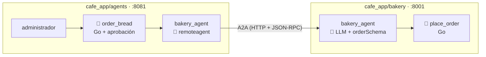

# cafe_app/bakery — la panadería La Espiga (fase 8)

La cafetería no hornea: le compra el pan a **La Espiga**, otro negocio con su propio agente. Este programa **es la panadería**: corre en su propio proceso (en la vida real, en otro servidor y de otra empresa), no sabe nada de la cafetería y no comparte con ella ni código ni base de datos. Se comunican por **A2A** (ver `my_agent_a2a`).



## Qué hace

| Pieza | Qué hace |
|---|---|
| `catalog` | Los panes y su precio por unidad para negocios (pan de queso, croissant, almojábana, pan integral) |
| `place_order` | Tool Go: valida el pan y la cantidad (1 a 200), **calcula el total** y numera el pedido (desde 1001) |
| `orderSchema` | La respuesta es un JSON con `status`, `order_id`, `product`, `quantity`, `total` y `message`: el contrato con quien le compra |

El catálogo de la instrucción se genera del mismo mapa que usa `place_order`, así que el agente no puede anunciar un precio distinto del que cobra. Los pedidos se numeran en memoria: al reiniciar vuelven a empezar en 1001.

Como no tiene código A2A, el mismo programa se puede probar con la interfaz del ADK (`web webui api`) o exponerse por A2A (`web a2a`): lo decide el launcher.

## Ejecutar

```bash
cd cafe_app/bakery
export GOOGLE_API_KEY=...                       # BAKERY_GEMINI_MODEL es opcional
go run . web -port 8001 a2a -a2a_agent_url http://localhost:8001
```

La agent card queda en http://localhost:8001/.well-known/agent-card.json. Los agentes de la cafetería la buscan en `CAFE_BAKERY_URL` (por defecto `http://localhost:8001`).
