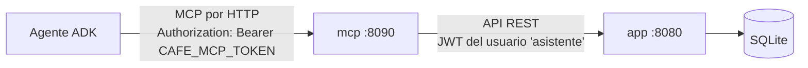

# cafe_app/mcp — servidor MCP de la cafetería (fase 2)

Expone la app como **tools MCP** para que los agentes consulten e ingresen datos. Se sirve por **HTTP** (Streamable HTTP, stateless; no usa stdio) y se protege con un **token bearer**.



El MCP no toca la base de datos: llama a la API de la app, así las reglas (stock, validaciones) viven en un solo lugar. Hace login con el usuario de servicio `asistente` (creado por el seed), guarda el JWT y vuelve a entrar si vence.

## Tools

| Tool | Qué hace |
|---|---|
| `list_menu` | Productos activos con id, categoría y precio |
| `get_stock` | Inventario; `low_only=true` deja solo el stock bajo |
| `list_customers` | Clientes con su id |
| `list_sales` | Últimas ventas (`limit`, por defecto 10; `date` AAAA-MM-DD para un solo día) |
| `list_reviews` | Reseñas con su calificación (`date` para un solo día) |
| `sales_summary` | Resumen de un día **calculado por el sistema**: ventas, total, ventas con descuento y más vendidos |
| `reviews_summary` | Resumen de un día calculado por el sistema: cantidad, promedio y reseñas de 1 o 2 estrellas |
| `create_sale` | Registra una venta y descuenta el stock; falla si no alcanza |
| `create_review` | Registra una reseña de 1 a 5 |

Los errores de la app (por ejemplo, "no hay stock suficiente de Pan de queso") llegan al modelo como resultado de error de la tool, para que se los explique al cliente.

## Ejecutar

```bash
# 1) la app
cd cafe_app/app && go run .

# 2) el MCP
cd cafe_app/mcp && CAFE_MCP_TOKEN=un-token-largo go run .
```

| Variable | Por defecto | Qué hace |
|---|---|---|
| `CAFE_MCP_TOKEN` | — (obligatoria) | Token que deben enviar los agentes |
| `CAFE_MCP_ADDR` | `:8090` | Dirección donde escucha |
| `CAFE_APP_URL` | `http://localhost:8080` | Dónde está la app |
| `CAFE_APP_USER` / `CAFE_APP_PASSWORD` | `asistente` / `asistente123` | Usuario de servicio para la API |

## Probar a mano

```bash
curl -s localhost:8090 \
  -H 'Content-Type: application/json' -H 'Accept: application/json, text/event-stream' \
  -H 'Authorization: Bearer un-token-largo' \
  -d '{"jsonrpc":"2.0","id":1,"method":"tools/call","params":{"name":"get_stock","arguments":{"low_only":true}}}'
```
