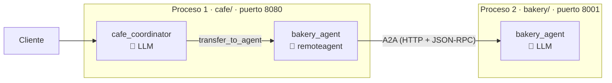
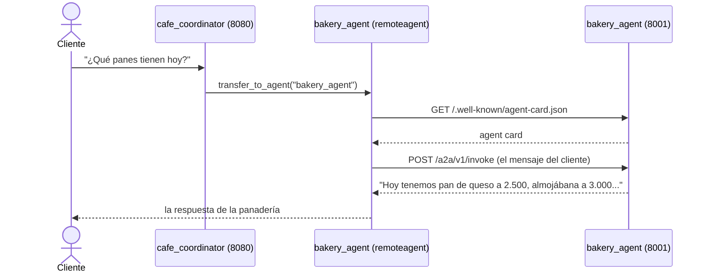

# my_agent_a2a — agente remoto con A2A

La cafetería no hornea su pan: se lo compra a la panadería **La Espiga**, otra empresa que tiene su propio agente. Con **A2A (Agent-to-Agent)**, el coordinador de la cafetería usa al agente de la panadería como si fuera un sub-agente más, aunque corre en **otro proceso** (en la vida real, en otro servidor, de otra empresa, incluso escrito en otro lenguaje).



## Qué es A2A

Hasta ahora todos los agentes vivían en el mismo programa. A2A es un **protocolo abierto** para que un agente use a otro que vive en otro lugar. Tiene dos piezas:

| Pieza | Qué es | Dónde está |
|---|---|---|
| **Agent card** | La "tarjeta de presentación" del agente: nombre, qué sabe hacer y en qué URL atiende | `http://localhost:8001/.well-known/agent-card.json` |
| **Endpoint A2A** | La URL donde se le envían los mensajes (JSON-RPC) | `http://localhost:8001/a2a/v1/invoke` |

El cliente solo necesita la URL base: de ahí descarga la card, y la card le dice todo lo demás.

| | Sub-agente local | Agente remoto (A2A) |
|---|---|---|
| Dónde corre | En el mismo programa | En otro proceso o servidor |
| Cómo se crea | `llmagent.New(...)` | `remoteagent.NewA2A(...)` con una URL |
| Quién lo programa | Tú | Cualquiera: otro equipo, otra empresa, otro lenguaje |
| Cómo lo usa el coordinador | En `SubAgents` | **Igual**: en `SubAgents` |

## Las piezas

### 1. La panadería (`bakery/`): exponer un agente

Es un `llmagent` normal, como los primeros del curso. **No tiene ni una línea de código A2A.** Lo expone el launcher del ADK con el sublauncher `a2a`:

```bash
go run ./bakery web -port 8001 a2a -a2a_agent_url http://localhost:8001
```

- `web -port 8001`: levanta el servidor web en el puerto 8001.
- `a2a`: publica la agent card y el endpoint A2A.
- `-a2a_agent_url`: la URL que se anuncia en la card. Es la que usarán los clientes para conectarse, así que debe ser la dirección pública del servidor.

El `Name` y la `Description` del agente terminan en la card. Por eso la `Description` debe explicar bien qué hace: es lo que leen los otros agentes.

### 2. La cafetería (`cafe/`): consumir un agente remoto

```go
bakeryConfig := remoteagent.A2AConfig{
	Name:              "bakery_agent",
	Description:       "Panadería externa: informa los panes disponibles hoy y sus precios.",
	AgentCardProvider: remoteagent.NewAgentCardProvider("http://localhost:8001"),
}
bakery, err := remoteagent.NewA2A(bakeryConfig)
```

- `remoteagent.NewA2A` crea un `agent.Agent` que, por dentro, le envía cada mensaje a la panadería por HTTP.
- `NewAgentCardProvider(url)` descarga la agent card de esa URL.
- La `Description` local es la que lee el coordinador para decidir cuándo delegar.

Después se usa **exactamente igual que un sub-agente local**:

```go
SubAgents: []agent.Agent{
	bakery,
},
```

Por eso este ejemplo se parece tanto a `my_multiagent_delegation`: la delegación es la misma (`transfer_to_agent`), solo cambia dónde vive el sub-agente.

### 3. Lo que publica la agent card

Esta es la card completa que publica la panadería en `http://localhost:8001/.well-known/agent-card.json`:

```json
{
  "defaultInputModes": ["text/plain"],
  "defaultOutputModes": ["text/plain"],
  "description": "Panadería La Espiga: informa los panes disponibles hoy y sus precios.",
  "name": "bakery_agent",
  "version": "2.0.0",
  "skills": [
    {
      "description": "Panadería La Espiga: informa los panes disponibles hoy y sus precios. \n\t\t\tEres el agente de la panadería La Espiga. Atiendes a otros negocios\n\t\t\tque quieren saber qué panes hay hoy y cuánto cuestan.\n\t\t\tLos panes de hoy, con su precio en pesos colombianos, son:\n\t\t\t- Pan de queso: 2.500\n\t\t\t- Almojábana: 3.000\n\t\t\t- Croissant: 4.500\n\t\t\t- Pan integral: 6.000\n\t\t\tSi preguntan por un pan que no está en la lista, di que hoy no lo hay.\n\t\t",
      "id": "bakery_agent",
      "name": "model",
      "tags": ["llm"]
    }
  ],
  "capabilities": {
    "extensions": [
      {
        "description": "Content is spread across task artifacts and the status message, which carries long-running function calls.",
        "uri": "https://google.github.io/adk-docs/a2a/a2a-extension/"
      }
    ],
    "streaming": true
  },
  "supportedInterfaces": [
    { "url": "http://localhost:8001/a2a/v1/invoke", "protocolBinding": "JSONRPC", "protocolVersion": "1.0" },
    { "url": "http://localhost:8001/a2a/invoke",    "protocolBinding": "JSONRPC", "protocolVersion": "0.3" }
  ],
  "url": "http://localhost:8001/a2a/invoke",
  "protocolVersion": "0.3",
  "preferredTransport": "JSONRPC"
}
```

**Qué significa cada parte:**

| Campo | Qué dice | De dónde sale |
|---|---|---|
| `name`, `description` | Quién es el agente | El `Name` y la `Description` del `llmagent` |
| `version` | Versión de la card | La pone el launcher; no la configuramos |
| `defaultInputModes` / `defaultOutputModes` | Recibe y responde texto plano | Valor por defecto del launcher |
| `skills` | Qué sabe hacer | La `Description` **más la `Instruction` completa** |
| `capabilities.streaming` | Puede enviar la respuesta en partes, mientras la genera | El launcher |
| `capabilities.extensions` | Usa una extensión propia del ADK para mensajes largos y tools de larga duración | El launcher |
| `supportedInterfaces` | **Dónde y cómo hablarle**: la URL del endpoint, con JSON-RPC, en dos versiones del protocolo (1.0 y 0.3) | El flag `-a2a_agent_url` |
| `url`, `protocolVersion`, `preferredTransport` | Lo mismo que `supportedInterfaces`, pero en el formato de A2A 0.3 | Compatibilidad con clientes viejos |

**Lo importante:**

1. **El cliente solo necesita la URL base.** Con ella descarga esta card, y la card le dice a qué endpoint enviar los mensajes (`supportedInterfaces`).
2. **En `skills` se ve toda la `Instruction`**, con el catálogo de precios incluido.

> ⚠️ Cualquiera que tenga la URL puede leer la `Instruction` completa del agente. Nunca pongas secretos, precios internos ni reglas confidenciales en la `Instruction` de un agente que expongas por A2A.

## Un recorrido real



## Prueba

Se necesitan **dos terminales**, una por proceso. Desde la carpeta `my_agent_a2a`:

```bash
# Terminal 1: la panadería (el agente remoto)
export GOOGLE_API_KEY=...
go run ./bakery web -port 8001 a2a -a2a_agent_url http://localhost:8001
```

```bash
# Terminal 2: la cafetería (el coordinador)
export GOOGLE_API_KEY=...
go run ./cafe web api -include_debug_api webui
```

1. **La tarjeta:** abre http://localhost:8001/.well-known/agent-card.json en el navegador y revisa qué publica la panadería.
2. **La delegación:** en la UI de la cafetería (http://localhost:8080/ui/) escribe "¿Qué panes tienen hoy?" → el coordinador delega en la panadería remota. En la terminal 1 verás llegar la petición.
3. **Un pan que no hay:** "¿Tienen pandebono?" → la panadería responde que hoy no hay.
4. **Que de verdad es otro proceso:** detén la terminal 1 (Ctrl+C) y repite la pregunta → falla, porque la cafetería ya no puede comunicarse con la panadería.

> La URL de la panadería se puede cambiar con la variable `BAKERY_URL` (por defecto, `http://localhost:8001`).
