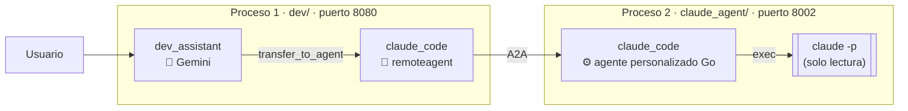
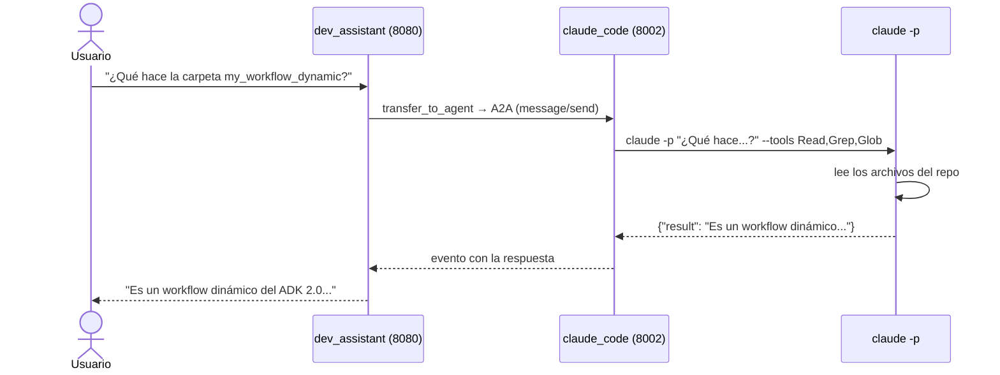

# my_agent_a2a_claude — Claude Code como agente A2A

Claude Code no habla A2A de forma nativa. Aquí lo **envolvemos en un agente personalizado del ADK** y lo exponemos por A2A, igual que la panadería de `my_agent_a2a`. Así, un coordinador hecho con Gemini puede delegarle preguntas sobre el código del repositorio del curso.



## Qué opciones da Claude Code para usarlo desde otro programa

| Opción | ¿Expone el agente completo? | Notas |
|---|---|---|
| A2A nativo | ❌ No existe | Por eso lo envolvemos nosotros |
| `claude mcp serve` | ❌ Solo las tools | Expone Read, Edit, Bash… por MCP, pero no el ciclo del agente: quien lo llama tiene que razonar |
| **Modo headless (`claude -p`)** | ✅ Sí | Ejecuta una tarea completa sin interfaz y responde en JSON. **Es lo que usamos aquí** |
| Claude Agent SDK | ✅ Sí | El mismo motor como librería, pero solo para Python y TypeScript |
| Remote Control | ❌ | Es para que una persona controle su sesión desde el navegador o el celular |

## Las piezas

### 1. `claude_agent/`: un agente personalizado del ADK

Hasta ahora todos los agentes eran `llmagent`: el ADK llamaba a Gemini por nosotros. Con **`agent.New`** escribimos nosotros la función `Run`, que recibe el mensaje y devuelve eventos. Dentro puede pasar cualquier cosa; aquí, ejecutamos Claude Code:

```go
claudeAgentConfig := agent.Config{
	Name:        "claude_code",
	Description: "Claude Code en modo solo lectura: responde preguntas sobre el código del repositorio del curso ADK.",
	Run: func(ctx agent.InvocationContext) iter.Seq2[*session.Event, error] {
		return func(yield func(*session.Event, error) bool) {
			answer, err := AskClaude(ctx, workDir, userText(ctx))  // ejecuta claude -p
			...
			event := session.NewEvent(ctx, ctx.InvocationID())
			event.Author = ctx.Agent().Name()
			event.LLMResponse = model.LLMResponse{
				Content: genai.NewContentFromText(answer, genai.RoleModel),
			}
			yield(event, nil)  // la respuesta de Claude Code sale como un evento del agente
		}
	},
}
```

| | `llmagent.New` | `agent.New` |
|---|---|---|
| Quién decide qué responder | El LLM configurado (Gemini) | Tu función `Run` |
| Qué hay dentro | Modelo, instrucción, tools | Cualquier código Go: llamar a un programa, una API, una base de datos… |
| Cómo responde | El ADK crea los eventos | Tú creas los eventos con `session.NewEvent` y los entregas con `yield` |

Para el resto del ADK, y para A2A, es un agente igual que cualquier otro. Por eso se expone con el mismo launcher que la panadería.

### 2. `AskClaude`: ejecutar Claude Code sin interfaz

```go
cmd := exec.CommandContext(ctx, "claude",
	"-p", prompt,                         // modo headless: ejecuta y termina
	"--output-format", "json",            // respuesta en JSON
	"--tools", "Read,Grep,Glob",          // solo puede leer y buscar archivos
	"--permission-mode", "dontAsk",       // todo lo demás se niega sin preguntar
)
cmd.Dir = workDir                         // la carpeta del repositorio
```

`claude -p` responde un JSON con muchos campos; solo usamos dos:

```json
{ "type": "result", "subtype": "success", "is_error": false, "result": "La respuesta de Claude Code...", "session_id": "..." }
```

### 3. Seguridad: por qué solo lectura

Exponer Claude Code por HTTP es exponer un agente que, con todas sus tools, **puede editar archivos y ejecutar comandos en tu máquina**. Cualquiera que llegue al endpoint A2A podría pedírselo. Por eso:

- `--tools "Read,Grep,Glob"`: Claude Code **solo tiene** esas tres tools. Bash, Edit y Write no existen en esa ejecución.
- `--permission-mode dontAsk`: si algo requiere permiso, se niega sin preguntar. En modo headless no hay nadie para aprobar.
- El servidor escucha en `localhost`: solo se puede llamar desde tu máquina.

Lo probamos pidiéndole por A2A "Crea un archivo hola_a2a.txt": respondió que no tiene herramientas para escribir, y el archivo no se creó.

### 4. `dev/`: el coordinador

Es igual a la cafetería de `my_agent_a2a`: un `llmagent` con Gemini que tiene al agente remoto en `SubAgents`. **No sabe que por dentro hay Claude Code**: para él es otro agente A2A, descrito por su agent card.

### 5. Tiempos de espera

Claude Code puede tardar varios segundos en leer el código; en las pruebas, una pregunta simple tardó unos 8 s. El launcher corta las respuestas a los 15 s por defecto, así que ambos servidores se levantan con `-write-timeout 5m`.

## Un recorrido real



## Prueba

Requisitos: tener Claude Code instalado y con sesión iniciada (el comando `claude` debe funcionar en la terminal). Desde la carpeta `my_agent_a2a_claude`:

```bash
# Terminal 1: Claude Code como agente A2A (no necesita GOOGLE_API_KEY)
go run ./claude_agent web -port 8002 -write-timeout 5m a2a -a2a_agent_url http://localhost:8002
```

```bash
# Terminal 2: el coordinador con Gemini
export GOOGLE_API_KEY=...
go run ./dev web -write-timeout 5m api -include_debug_api webui
```

1. **La tarjeta:** abre http://localhost:8002/.well-known/agent-card.json. Como no es un `llmagent`, en `skills` solo aparece la `Description` (con `"name": "custom"` y la etiqueta `custom_agent`), no hay instrucción que se filtre.
2. **Una pregunta sobre el código:** en la UI (http://localhost:8080/ui/), "¿Qué hace la carpeta my_workflow_dynamic?" → el coordinador delega en Claude Code, que lee el repositorio y responde.
3. **Solo lectura:** "Pídele a claude_code que cree un archivo hola.txt" → Claude Code responde que no puede escribir archivos.
4. **Sin el coordinador:** también se le puede hablar directo por A2A, sin Gemini:

```bash
curl -s localhost:8002/a2a/invoke -H 'Content-Type: application/json' -d '{
  "jsonrpc": "2.0", "id": 1, "method": "message/send",
  "params": { "message": { "role": "user", "messageId": "m1",
    "parts": [{ "kind": "text", "text": "En una sola frase: ¿qué hace la carpeta my_workflow_dynamic?" }] } }
}' | jq -r '.result.artifacts[].parts[].text'
```

> Variables opcionales: `CLAUDE_WORKDIR` cambia la carpeta en la que trabaja Claude Code (por defecto, la raíz del repositorio) y `CLAUDE_AGENT_URL` cambia la URL que usa el coordinador (por defecto, `http://localhost:8002`).

## Limitaciones

- **Sin memoria entre mensajes:** cada mensaje ejecuta un `claude -p` nuevo, así que Claude Code no recuerda la pregunta anterior. Se podría guardar el `session_id` de la respuesta y pasarlo con `--resume` en el siguiente mensaje.
- **Cada pregunta tiene costo:** cada mensaje es una ejecución completa de Claude Code.
- **Sin streaming:** la respuesta llega completa al final, no por partes.
