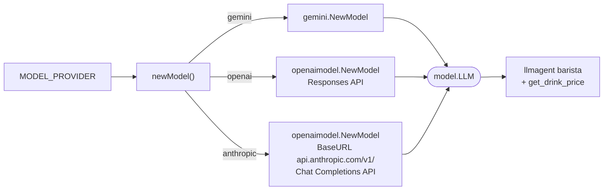
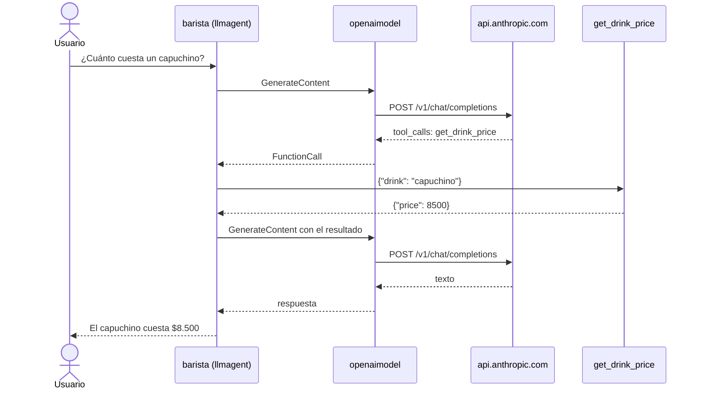

# Agente con modelos de otros proveedores (OpenAI y Anthropic)

Hasta ahora todos los agentes usaban Gemini con `gemini.NewModel`. Este ejemplo
muestra que el agente **no depende del proveedor**: `llmagent.Config.Model`
recibe cualquier cosa que cumpla la interfaz `model.LLM`, y el ADK Go trae dos
implementaciones:

| Paquete | Proveedor |
| :---- | :---- |
| `model/gemini` | Gemini (Google AI Studio o Vertex AI) |
| `model/openaimodel` | OpenAI y cualquier proveedor **compatible con la API de OpenAI** (experimental) |

El agente es un barista con una sola tool, `get_drink_price`, y una regla:
nunca inventar precios. Así se comprueba que el *function calling* funciona
igual con los tres proveedores.

## ¿Y LiteLLM?

En el ADK de **Python** se usa `LiteLlm("openai/gpt-...")` para hablar con otros
proveedores, porque LiteLLM es una librería de Python. En el ADK de **Go** no
existe: su equivalente es `openaimodel`. Muchos proveedores (Anthropic, Groq,
DeepSeek, Ollama, OpenRouter, el propio proxy de LiteLLM…) exponen un endpoint
compatible con OpenAI, así que basta con cambiar el `BaseURL`.

## Cómo se elige el modelo



`openaimodel` puede hablar con dos APIs de OpenAI, elegidas con
`ClientConfig.API`:

- `APIResponses` (valor por defecto): `POST /v1/responses`, la API nueva de OpenAI.
- `APIChatCompletions`: `POST /v1/chat/completions`, la que implementan casi todos
  los proveedores compatibles. Anthropic solo ofrece esta.

```go
clientConfig := openaimodel.ClientConfig{
    APIKey:  apiKey,
    BaseURL: "https://api.anthropic.com/v1/",
    API:     openaimodel.APIChatCompletions,
}
```

## Flujo de una pregunta (con Anthropic)



## Variables de entorno

| Variable | Uso |
| :---- | :---- |
| `MODEL_PROVIDER` | `gemini` (por defecto), `openai` o `anthropic` |
| `MODEL_NAME` | Opcional. Por defecto: `gemini-3.8-flash`, `gpt-5-mini` o `claude-haiku-4-5` |
| `GOOGLE_API_KEY` | Clave de Gemini |
| `OPENAI_API_KEY` | Clave de OpenAI |
| `ANTHROPIC_API_KEY` | Clave de Anthropic |

## Prueba sugerida

```bash
# Gemini
go run . web api webui

# OpenAI
MODEL_PROVIDER=openai go run . web api webui

# Anthropic
MODEL_PROVIDER=anthropic go run . web api webui
```

Haz las mismas preguntas con cada proveedor:

1. `¿Cuánto cuesta un capuchino?` → llama a la tool y responde $8.500.
2. `¿Y un té chai?` → la tool devuelve error y el barista dice que no está en el menú.

## Notas

- `openaimodel` es **experimental**: su comportamiento puede cambiar.
- Rechaza con error los campos de `GenerateContentConfig` que la API de OpenAI no
  tiene (por ejemplo `TopK` o `SafetySettings`) y las tools propias de Gemini, como
  `geminitool.GoogleSearch`. Con otros proveedores solo se usan function tools y MCP.
- El endpoint compatible de Anthropic es una capa de compatibilidad: no expone
  todas las funciones de la API nativa de Claude (por ejemplo, prompt caching).
- Si se usa `BaseURL`, configura siempre `APIKey`: si va vacío, el cliente de
  OpenAI toma `OPENAI_API_KEY` y la enviaría a otro proveedor.
