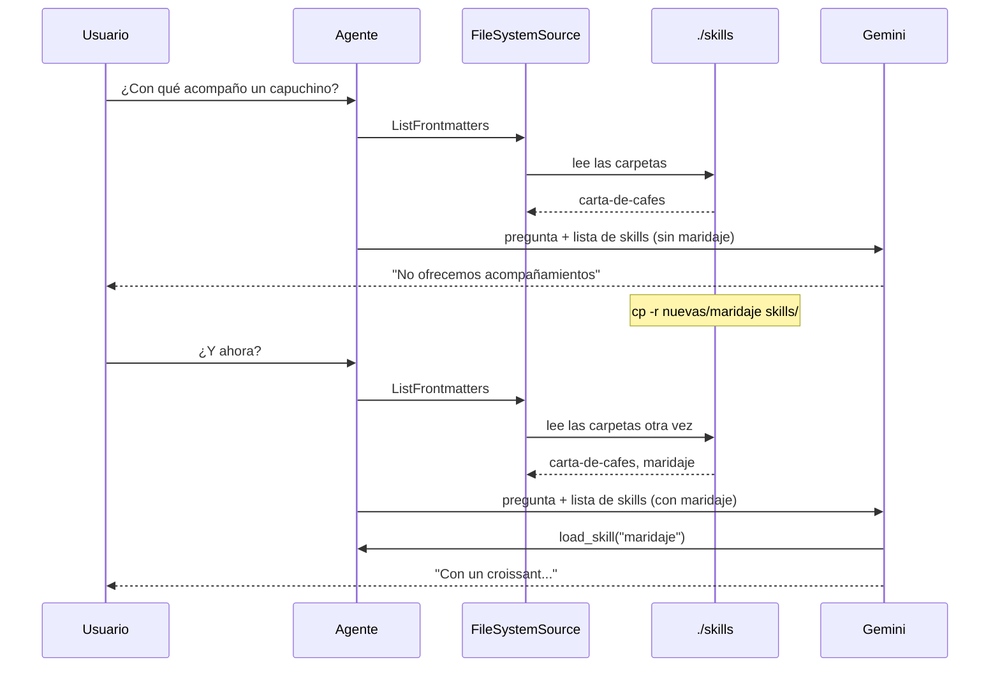

# my_agent_with_skills_reload — recargar skills sin reiniciar

El asistente de la cafetería arranca con una sola skill, `carta-de-cafes`. Con el agente **andando**, copias una carpeta nueva a `skills/` y el agente la usa en el siguiente mensaje. No hay que recompilar ni reiniciar nada.

```
my_agent_with_skills_reload/
├── main.go
├── skills/                 → lo que el agente ve
│   └── carta-de-cafes/
│       └── SKILL.md
└── nuevas/                 → skills listas para copiar en clase
    └── maridaje/
        └── SKILL.md
```

## Por qué funciona

El código es igual al de `my_agent_with_skills`. La recarga no se programa: sale de cómo el ADK usa la fuente de skills.

1. **Antes de cada llamada al modelo**, el agente le pide al toolset de skills que agregue la lista de skills a la petición (`ProcessRequest` → `source.ListFrontmatters`, en `internal/llminternal/base_flow.go`). Esto pasa en cada paso, no una sola vez al arrancar.
2. `skill.NewFileSystemSource(os.DirFS("./skills"))` **vuelve a leer la carpeta** cada vez que se le pide la lista. No guarda nada en memoria.
3. `load_skill` y `load_skill_resource` también leen del disco en el momento en que el modelo los llama. Si editas un `SKILL.md`, el cambio vale desde el siguiente mensaje.

No hay un vigilante de archivos: la carpeta se lee cada vez que hace falta.



## El caché anula la recarga

El paquete `skill` trae dos fuentes con caché, pensadas para no leer el disco en cada petición:

| Fuente | Qué guarda en memoria | ¿Ve una skill nueva? |
|---|---|---|
| `NewFileSystemSource` | Nada | **Sí**, en el siguiente mensaje |
| `WithFrontmatterPreloadSource` | Nombre y descripción de cada skill | Solo si llamas a la función `reload()` que devuelve |
| `WithCompletePreloadSource` | Todo: instrucciones y recursos | Solo si llamas a `reload()` |

Usa caché cuando las skills no cambian mientras el agente corre (por ejemplo, embebidas con `go:embed`) o cuando están en una fuente lenta. Si quieres recarga sin reiniciar, usa la fuente sin caché o llama a `reload()` cuando sepas que algo cambió.

## Cómo probarlo

```bash
cd my_agent_with_skills_reload
export GOOGLE_API_KEY=...        # o: set -a && . ./.env && set +a
go run . web api webui
```

Abre http://localhost:8080 y sigue estos pasos:

1. Pregunta **"¿Con qué acompaño un capuchino?"**. El agente solo tiene la carta: responde que no ofrecen acompañamientos.
2. En otra terminal, **sin detener el agente**:

   ```bash
   cp -r nuevas/maridaje skills/
   ```

3. Pregunta otra vez. El agente llama a `load_skill("maridaje")` y recomienda un croissant.
4. Para volver a empezar: `rm -rf skills/maridaje`.

### Lo que pasó al probarlo

| Paso | Llamadas | Respuesta |
|---|---|---|
| Sin `maridaje` | `load_skill("carta-de-cafes")` | "No ofrecemos alimentos o acompañamientos" |
| Tras `cp -r nuevas/maridaje skills/` | `load_skill("maridaje")` | "Un capuchino se acompaña idealmente con un croissant..." |
| Tras `rm -rf skills/maridaje`, en la misma conversación | `load_skill("maridaje")` falla, luego `list_skills` | Igual recomienda galletas de avena para el latte |

El último caso es un detalle para explicar en clase: **borrar una skill la quita de la lista, pero lo que el agente ya leyó sigue en el historial de la conversación**. En una conversación nueva, el agente ya no la conoce.

## Cuidado: una skill mal escrita detiene al agente

Si en `skills/` hay una carpeta cuyo nombre no coincide con el `name` de su `SKILL.md`, o con el encabezado mal escrito, `ListFrontmatters` devuelve un error. Como la lista se pide en cada mensaje, **el agente falla en todos los mensajes** hasta que alguien arregla o borra esa carpeta. Las carpetas sin `SKILL.md` sí se ignoran.

Por eso, antes de copiar una skill a la carpeta de un agente que está andando, revisa que el nombre de la carpeta y el `name` coincidan.
