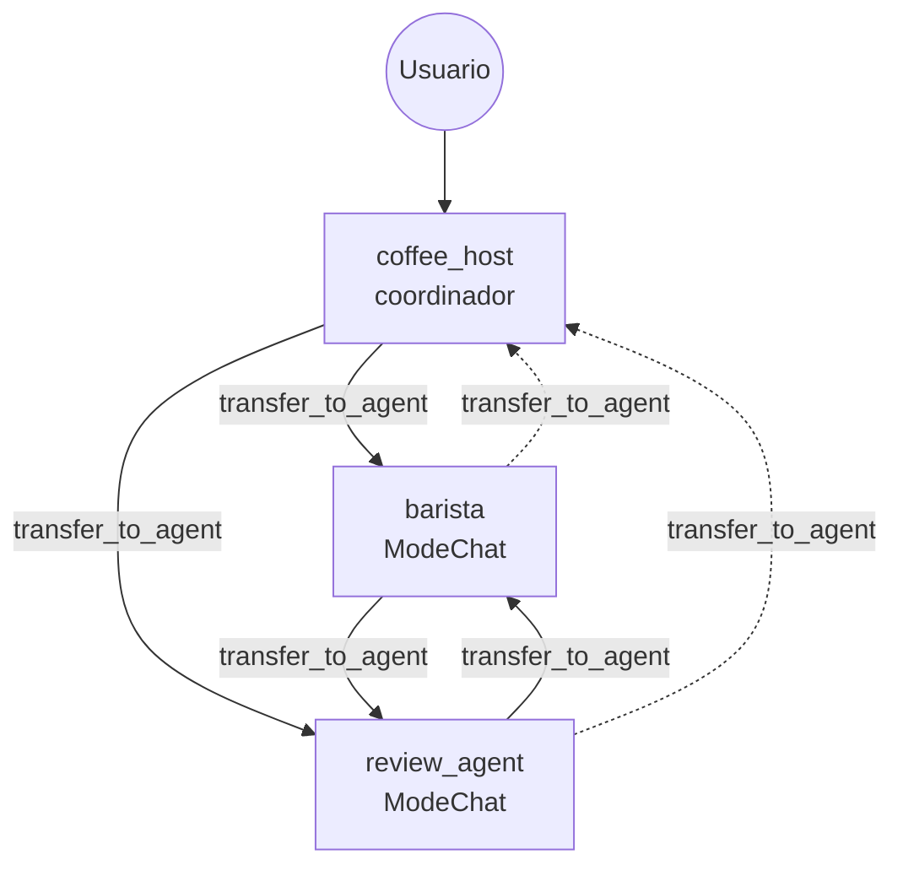
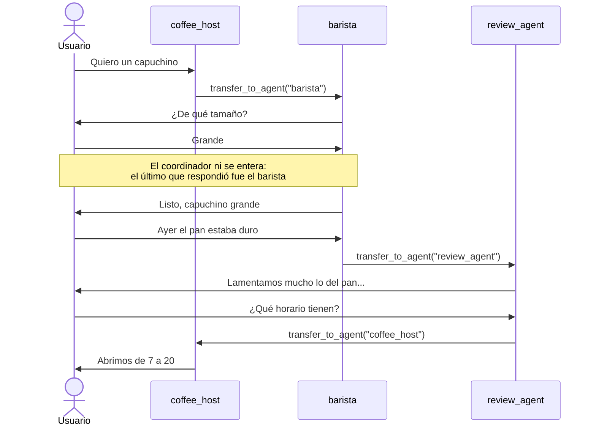

# my_multiagent_delegation — delegación con `ModeChat`

Un coordinador (`coffee_host`) recibe al cliente y le **cede la conversación** al sub-agente adecuado:

- `barista`: pedidos de bebidas.
- `review_agent`: opiniones y quejas.



## Cómo funciona

- Basta con poner los agentes en `SubAgents` del coordinador. Los sub-agentes no declaran `Mode`, así que quedan en **`ModeChat`**, el valor por defecto.
- Con `SubAgents`, el ADK le agrega a cada agente la tool **`transfer_to_agent`**. El LLM decide a quién transferir leyendo la **`Description`** de cada sub-agente, por eso debe ser clara.
- Un sub-agente en `ModeChat` puede transferir a su **padre** (el coordinador) y a sus **pares** (los otros sub-agentes). Viene así por defecto porque `DisallowTransferToParent` y `DisallowTransferToPeers` son `false`.

## Modo chat: te quedas hablando con el último agente

Con cada mensaje nuevo, el runner busca **el último agente que respondió** en la sesión y le entrega el mensaje a él. Solo si no hay ninguno, usa el coordinador (`runner/runner.go`, `findAgentToRun`).

Por eso **te quedas hablando con el sub-agente hasta que le pidas algo diferente a lo que sabe hacer**. En ese momento, si su LLM lo decide, transfiere la conversación al coordinador o a otro sub-agente. El control **no vuelve solo**.



> Si el sub-agente intenta responder él mismo algo que no le corresponde, en lugar de transferir, te quedas con él. Para reforzar el regreso, se puede agregar a su instrucción: "si te piden algo fuera de tu tema, devuélvele la conversación al coordinador".

## El grafo de la UI no muestra flechas

El generador de grafos del ADK Go (`server/adkrest/internal/services/agentgraphgenerator.go`) solo dibuja líneas de **agente → tool** y entre los pasos de un workflow secuencial o en bucle. Los `SubAgents` en `ModeChat` no son tools, porque `transfer_to_agent` se inyecta al ejecutar. Por eso aparecen como nodos 🤖 sueltos.

Los colores sí indican algo: en verde, los agentes que participaron en el evento seleccionado; en gris, los que no.

## Prueba

```bash
export GOOGLE_API_KEY=...
go run . web api webui
```

1. "Hola, quiero un capuchino" → responde el **barista**.
2. "Por cierto, ayer el pan estaba duro" → el barista transfiere al **review_agent**.
3. "¿Qué horario tienen?" → el review_agent devuelve la conversación al **coordinador**.

Compáralo con [`my_multiagent_modes`](../my_multiagent_modes), donde el control vuelve solo al coordinador.
