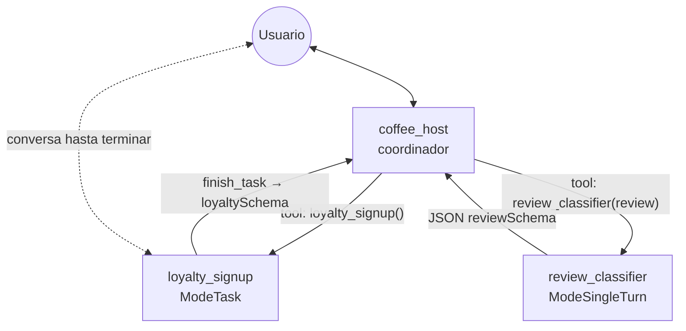
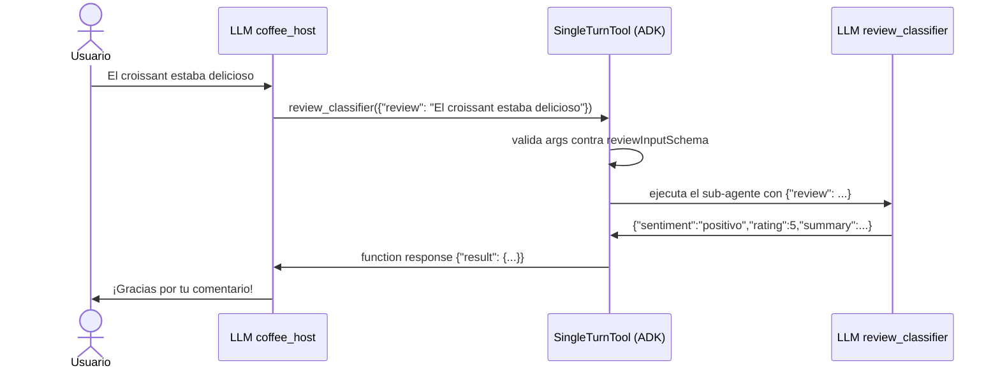
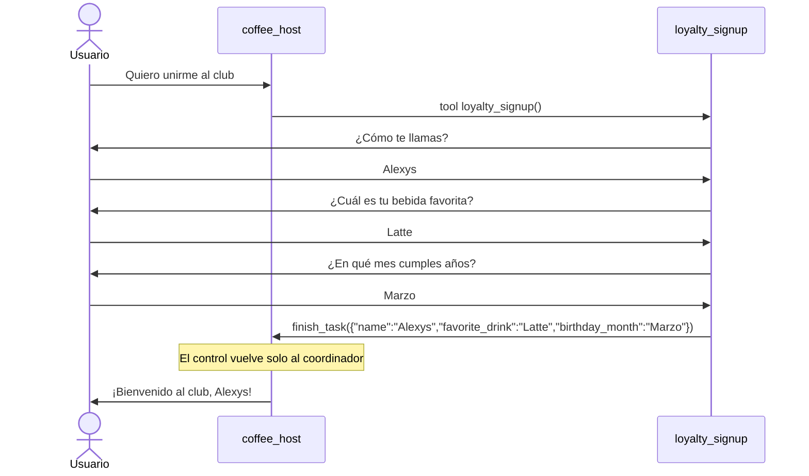

# my_multiagent_modes — sub-agentes en `ModeTask` y `ModeSingleTurn`

El coordinador (`coffee_host`) **encarga** trabajo a dos sub-agentes y siempre recupera el control:

| Sub-agente | Modo | Qué hace |
|---|---|---|
| `loyalty_signup` | `ModeTask` | Inscribe al cliente en el club. **Conversa** hasta tener nombre, bebida favorita y mes de cumpleaños. |
| `review_classifier` | `ModeSingleTurn` | Clasifica una reseña. **No habla** con el usuario. |



## Los tres modos de un sub-agente

| Modo | ¿Habla con el usuario? | ¿Quién atiende tu siguiente mensaje? | ¿Cómo lo alcanza el padre? |
|---|---|---|---|
| `ModeChat` (ver [`my_multiagent_delegation`](../my_multiagent_delegation)) | Sí | El último agente que respondió, **hasta que preguntes algo diferente** a lo que sabe hacer y él decida transferir. | `transfer_to_agent` |
| `ModeTask` | Sí, solo lo necesario para su tarea | El sub-agente, **hasta que termina la tarea**. Al llamar `finish_task`, el control **vuelve solo** al coordinador con el resultado. | Como una **tool** |
| `ModeSingleTurn` | **Nunca** | Siempre el coordinador. El sub-agente hace su trabajo en un solo turno y devuelve el resultado. | Como una **tool** |

## El ADK los convierte en tools

Al crear el coordinador con `llmagent.New`, el ADK recorre sus `SubAgents` (`agent/llmagent/llmagent.go`, `installTaskTools`). A cada uno en `ModeTask` o `ModeSingleTurn` lo envuelve en una **tool del coordinador**:

- `name` = `Name` del sub-agente
- `description` = `Description` del sub-agente
- `parameters` = `InputSchema` del sub-agente. Si no tiene, usa `{"request": string}`.

Al agente en `ModeTask` además le agrega la tool **`finish_task`**, cuyos parámetros son su `OutputSchema`.

### Modo single turn: el `InputSchema` lo llena el LLM del coordinador

Nadie en nuestro código envía `reviewInputSchema`. Ese esquema se vuelve los parámetros de la tool `review_classifier(review)`, y es el **LLM del coordinador** quien extrae la reseña del mensaje del usuario para llenarlo.



### Modo task: conversa y luego devuelve el control

La tool `loyalty_signup` no ejecuta nada por sí misma. Cuando el coordinador la llama, el ADK le pasa la conversación al sub-agente. Este pregunta lo que falte y, al terminar, llama a `finish_task` con un JSON que cumple `loyaltySchema`. Ese JSON llega al coordinador como respuesta de la tool, y el control vuelve a él.



## Por qué ahora el grafo sí tiene flechas

El generador de grafos de la UI solo dibuja líneas de **agente → tool**. Como el ADK convirtió a estos sub-agentes en tools del coordinador, aparecen como nodos 🔧 unidos a `coffee_host`. En `my_multiagent_delegation` eran sub-agentes en `ModeChat` y aparecían como nodos 🤖 sueltos.

## Archivos

- `schemas.go`: `reviewSchema` (salida del clasificador), `reviewInputSchema` (entrada del clasificador) y `loyaltySchema` (salida de la inscripción).
- `main.go`: los tres agentes. Los sub-agentes solo se diferencian por su `Mode`.

## Prueba

```bash
export GOOGLE_API_KEY=...
go run . web api -include_debug_api webui
```

> Desde ADK v2.5.0, el grafo y las trazas de la UI necesitan `-include_debug_api`. La UI queda en http://localhost:8080/ui/.

1. "Quiero unirme al club" → `loyalty_signup` pregunta los datos y, al terminar, `coffee_host` te da la bienvenida por tu nombre.
2. "El croissant estaba delicioso" → `coffee_host` llama a `review_classifier`, recibe el JSON y responde él mismo.
