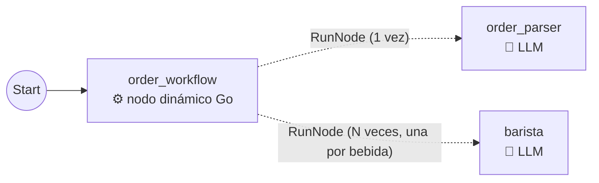
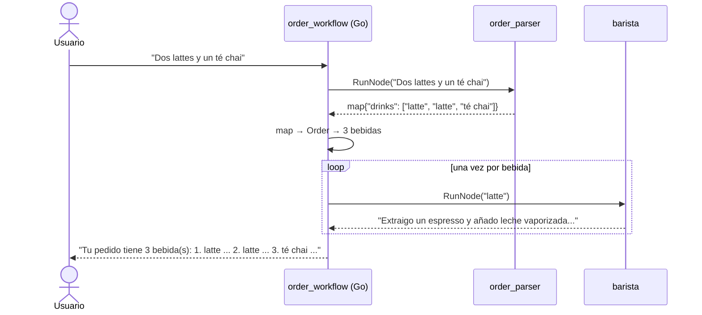

# my_workflow_dynamic — workflow dinámico (ADK 2.0)

Un pedido de cafetería con **cualquier cantidad de bebidas**. Un nodo dinámico, escrito en Go, llama al `order_parser` para extraer las bebidas y luego llama al `barista` **una vez por cada bebida**:



La única arista real es `Start → order_workflow`. Las líneas punteadas **no son aristas**: son llamadas que hace el código Go con `workflow.RunNode`.

## Por qué un workflow dinámico y no un grafo

En el grafo (`my_workflow_graph`) declarábamos las cintas por adelantado: de este nodo pasa a este otro. Eso funciona cuando conoces la forma del flujo antes de ejecutarlo.

Aquí no la conoces: si el cliente pide 1 bebida, el barista trabaja 1 vez; si pide 4, trabaja 4 veces. **La cantidad de pasos solo se sabe en tiempo de ejecución**, y un grafo fijo no puede expresarla. En un workflow dinámico el orden lo decide código Go normal: `for`, `if`, `return`.

| | Grafo | Dinámico |
|---|---|---|
| Quién define el orden | Las aristas (`Edges`, `Chain`, `Route`) | Código Go dentro de un nodo |
| Cómo se llama a otro nodo | Por una arista | Con `workflow.RunNode(...)` |
| Ramas | `Route` + `Default` | Un `if` |
| Repetir un paso N veces | No se puede si N no se conoce antes | Un `for` |
| Diagrama | Se dibuja tal cual | El diagrama es el código |

## Las piezas

### 1. Agentes y nodos

| Nodo | Tipo | Qué hace |
|---|---|---|
| `order_parser` | `AgentNode` (LLM) | Responde un JSON con la lista de bebidas (`OutputSchema`) |
| `barista` | `AgentNode` (LLM) | Explica en dos líneas cómo prepara **una** bebida |
| `order_workflow` | `DynamicNode` (Go) | Orquesta todo: llama al parser, revisa, y llama al barista por cada bebida |

Los agentes se convierten en nodos con `workflow.NewAgentNode`, igual que en el grafo. La diferencia es que **no los conectamos con aristas**: se los pasamos al nodo dinámico para que él los llame.

### 2. El nodo dinámico

```go
orderWorkflow := func(ctx agent.Context, request string, emit func(*session.Event) error) (string, error) {
	// 1. El order_parser (LLM) extrae las bebidas
	parserOutput, err := workflow.RunNode[map[string]any](ctx, parserNode, request)
	...
	// json.Marshal + json.Unmarshal: del map a nuestro struct Order

	// 2. Si no hay bebidas, respondemos sin llamar al barista
	if len(order.Drinks) == 0 {
		return "No entendí tu pedido. ¿Qué bebidas quieres?", nil
	}

	// 3. Un barista por cada bebida
	for i, drink := range order.Drinks {
		preparation, err := workflow.RunNode[string](ctx, baristaNode, drink, workflow.WithUseSubBranch())
		...
	}

	// 4. Lo que devuelve el nodo dinámico es la respuesta final
	return ticket.String(), nil
}

workflow.NewDynamicNode("order_workflow", orderWorkflow, workflow.NodeConfig{})
```

- **`request`** es el mensaje del usuario: lo que entrega `Start`.
- **`workflow.RunNode[T](ctx, nodo, input)`** ejecuta un nodo y **devuelve su salida** como una función normal. La `T` se explica en la siguiente sección.
- El `ctx` debe ser el que recibe el nodo dinámico: así el ADK sabe que el barista es un "hijo" de `order_workflow` y registra cada llamada en la sesión.
- **`return`** es la salida del nodo dinámico. Como es el último nodo, es lo que ve el usuario.

### 3. `RunNode[T]`: qué es la `T`

`RunNode[T]` significa "**ejecuta este nodo y entrégame su resultado como un `T`**". La `T` es el tipo de dato que tú le dices que esperas recibir.

#### Por qué existe la `T`

Un nodo puede devolver cualquier cosa: texto, un map, un número o un struct. Por dentro, el ADK guarda esa salida como `any`, una "caja" que puede contener cualquier tipo. Con la `T` le dices a `RunNode` qué esperas encontrar en la caja, y él te lo entrega ya con ese tipo, listo para usar:

```go
preparation, err := workflow.RunNode[string](ctx, baristaNode, "latte")
// preparation es string: puedes usar strings.TrimSpace(preparation) directamente
```

Sin la `T` recibirías un `any` y tendrías que convertirlo tú en cada llamada.

#### Qué hace por dentro

En el código del ADK (`workflow/run_node.go`) son tres pasos:

```go
rawOut, err := ss.RunNode(child, input, o)  // 1. ejecuta el nodo → rawOut es any (la caja)
typed, ok := rawOut.(OUT)                   // 2. ¿lo que hay en la caja es exactamente un T?
if !ok {
    return zero, fmt.Errorf("... output type %T does not satisfy expected %T", ...)  // 3. si no, error
}
return typed, nil
```

El paso 2 es una aserción de tipo (`rawOut.(OUT)`): **solo revisa, no convierte.** Si en la caja hay un `map` y pediste `string`, no lo transforma; falla con:

```
workflow.RunNode: child "order_parser" output type map[string]interface {} does not satisfy expected string
```

#### Cómo saber qué `T` poner

Depende de lo que devuelva el nodo:

| Nodo | Qué devuelve | `T` |
|---|---|---|
| `AgentNode` sin `OutputSchema` (barista) | El texto que respondió el LLM | `string` |
| `AgentNode` con `OutputSchema` (order_parser) | El JSON ya convertido en map | `map[string]any` |
| `FunctionNode` de Go | Lo que retorne tu función | Ese mismo tipo (por ejemplo, `string` si tu función retorna `(string, error)`) |

#### La analogía

Es como pedir un paquete en una oficina de envíos:

- `RunNode` es el empleado que va a la bodega (ejecuta el nodo) y vuelve con una caja (`any`).
- La `T` es lo que dices al pedirlo: "es un sobre" (`string`) o "es una caja con compartimentos" (`map`).
- El empleado abre la caja y revisa. Si coincide, te lo entrega. Si pediste un sobre y era una caja, te dice "esto no es lo que pediste" y no te entrega nada. **Nunca convierte una cosa en otra.**

#### En este ejemplo

```go
// order_parser tiene OutputSchema → la caja trae un map
parserOutput, err := workflow.RunNode[map[string]any](ctx, parserNode, request)

// barista no tiene OutputSchema → la caja trae texto
preparation, err := workflow.RunNode[string](ctx, baristaNode, drink, workflow.WithUseSubBranch())
```

Después del primer `RunNode`, el `json.Marshal` + `json.Unmarshal` pasa ese map genérico a nuestro struct `Order`, para poder usar `order.Drinks` con su tipo. Esa conversión la hacemos nosotros, porque `RunNode` no la hace.

### 4. `WithUseSubBranch`: que cada barista solo vea su bebida

Por defecto, todos los hijos de un nodo dinámico comparten el historial. Sin esta opción, al preparar la tercera bebida el barista vería también las dos preparaciones anteriores en su prompt, y podría mezclarlas o repetirlas.

`workflow.WithUseSubBranch()` le da a cada llamada su propia rama, así cada barista solo ve la bebida que le toca.

### 5. Llamar al mismo nodo varias veces

El ADK numera automáticamente cada llamada al mismo nodo (`barista@1`, `barista@2`, …). Por eso se puede llamar al barista dentro de un `for` sin configurar nada más.

Esa numeración también sirve si el workflow se interrumpe y se reanuda: los hijos que ya terminaron no se vuelven a ejecutar, el ADK reutiliza su salida guardada. Por eso los nodos dinámicos tienen `RerunOnResume` activado por defecto.

## Un recorrido real



## Prueba

```bash
export GOOGLE_API_KEY=...
go run . web api -include_debug_api webui
```

> La UI queda en http://localhost:8080/ui/. El dibujo de grafos de la UI no entiende los `workflowagent` (ver `my_workflow_graph`), así que no esperes ver las llamadas de `RunNode` ahí: usa el diagrama de este README.

1. **Una bebida:** "Quiero un latte" → el barista se ejecuta 1 vez.
2. **Varias bebidas:** "Dos lattes, un capuchino y un té chai" → el barista se ejecuta 4 veces. Mismo código, distinta cantidad de pasos.
3. **Sin pedido:** "Hola, ¿qué tal?" → el `if` responde "No entendí tu pedido" sin llamar al barista.

En la pestaña de eventos de la UI se ve cada llamada del barista por separado.
