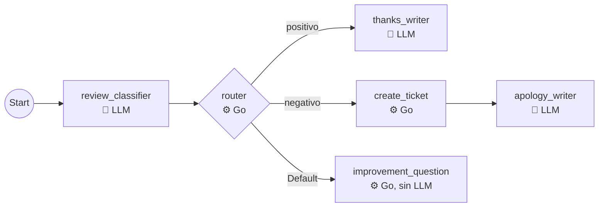
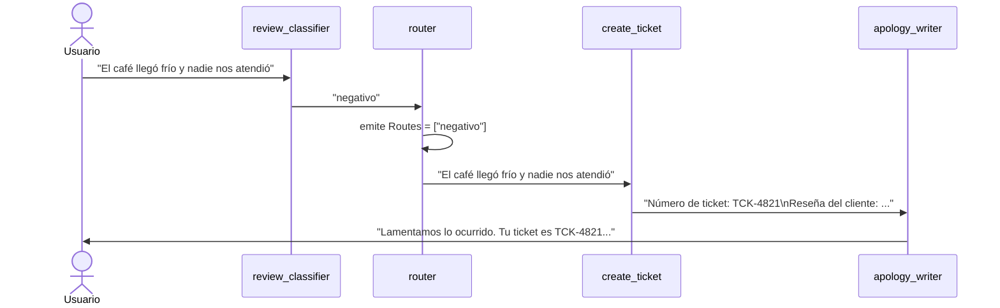

# my_workflow_graph — workflow de grafo (ADK 2.0)

Un grafo que clasifica la reseña de un cliente y la responde **por un camino distinto según el sentimiento**, mezclando nodos con LLM y nodos de código Go:



## Por qué un grafo y no las plantillas

Las plantillas que ya vimos (`sequentialagent`, `parallelagent`, `loopagent`) tienen una forma fija: todos los pasos en línea, todos a la vez o todos en bucle. Un grafo permite **cualquier forma**: ramas, caminos que se unen, pasos que solo corren a veces. Además, los pasos no tienen que ser agentes: pueden ser **funciones Go** comunes.

| | Plantillas | Grafo |
|---|---|---|
| Forma del flujo | Fija (línea, paralelo o bucle) | Libre: tú declaras las aristas |
| ¿Qué puede ser un paso? | Solo agentes | Agentes, funciones Go, tools… |
| Ramas según una condición | No (solo el LLM decide, con delegación) | Sí, con **routing** |
| Paso de datos | Por el estado (`OutputKey` → `{clave}`) | La **salida de un nodo es el input del siguiente** |

La documentación de ADK presenta los grafos como el enfoque moderno (ADK 2.0+) y las plantillas como el anterior.

## Cómo se conecta todo: una fábrica

En `main.go` aparecen agentes, funciones, nodos, `emit`, `Chain` y edges. Para entender cómo se conectan, piensa en una **fábrica** con tres capas: los trabajadores, las estaciones donde trabajan y las cintas que conectan las estaciones.

| En `main.go` | En la fábrica | Qué es |
|---|---|---|
| **Agentes** (`llmagent.New`) | Trabajadores con cerebro (LLM) | Saben hacer algo, pero solos no están en ningún lugar |
| **Funciones Go** (`Route`, `CreateTicket`…) | Máquinas automáticas | Hacen algo fijo, sin pensar |
| **Nodos** (`NewAgentNode`, `NewFunctionNode`) | **Estaciones** de la fábrica | Ponen a un trabajador o una máquina en un puesto |
| **Edges y Chain** | **Cintas transportadoras** entre estaciones | Dicen de qué estación pasa el trabajo a cuál |
| **Route** (`StringRoute`, `Default`) | **Letreros** en las bifurcaciones | Dicen qué cinta tomar |
| **`workflowagent.New`** | **La fábrica completa** | Junta todo y lo pone a funcionar |

### Capa 1: trabajadores y máquinas (todavía sueltos)

```
 AGENTES (LLM)                         FUNCIONES GO (en nodes.go)
 ┌──────────────────┐                  ┌──────────────────────┐
 │ reviewClassifier │                  │ Route                │
 │ thanksWriter     │                  │ CreateTicket         │
 │ apologyWriter    │                  │ ImprovementQuestion  │
 └──────────────────┘                  └──────────────────────┘
   Saben hacer algo, pero aún no están conectados a nada.
```

### Capa 2: cada uno recibe su estación (nodos)

```go
classifierNode, err := workflow.NewAgentNode(reviewClassifier, workflow.NodeConfig{})   // 🤖 estación con LLM
thanksNode, err := workflow.NewAgentNode(thanksWriter, workflow.NodeConfig{})           // 🤖
apologyNode, err := workflow.NewAgentNode(apologyWriter, workflow.NodeConfig{})         // 🤖
routerNode := workflow.NewEmittingFunctionNode("router", Route, workflow.NodeConfig{})  // ⚙️ máquina que además pone letreros
ticketNode := workflow.NewFunctionNode("create_ticket", CreateTicket, workflow.NodeConfig{})                    // ⚙️
improvementNode := workflow.NewFunctionNode("improvement_question", ImprovementQuestion, workflow.NodeConfig{}) // ⚙️
```

El grafo **solo trabaja con nodos**. Un agente o una función solo entra al grafo cuando lo conviertes en nodo.

`Emitting` significa que, además de devolver su resultado, esa máquina puede **colgar un letrero** (`emit` con `Routes`). Solo el router lo necesita.

### Capa 3: las cintas (edges)

```go
edges := workflow.Concat(
	workflow.Chain(workflow.Start, classifierNode, routerNode),                           // ①
	[]workflow.Edge{
		{From: routerNode, To: thanksNode, Route: workflow.StringRoute("positivo")},      // ②
		{From: routerNode, To: ticketNode, Route: workflow.StringRoute("negativo")},      // ③
		{From: routerNode, To: improvementNode, Route: workflow.Default},                 // ④
	},
	workflow.Chain(ticketNode, apologyNode),                                              // ⑤
)
```

- `Chain(a, b, c)` es un atajo para "cinta de a a b y de b a c", sin letreros.
- `Edge{From, To, Route}` es una cinta con letrero: solo se usa si el letrero coincide.
- `Concat(...)` junta todas las cintas en una sola lista.

### Todo junto: la fábrica armada

```
            ① Chain (cintas sin letrero)
 ┌───────┐        ┌───────────────────┐        ┌──────────────┐
 │ Start │ ─────► │ 🤖 classifierNode │ ─────► │ ⚙️ routerNode│
 └───────┘        └───────────────────┘        └──────┬───────┘
 (mensaje del      responde "negativo"                │ cuelga el letrero: Routes = ["negativo"]
  usuario)                                            │
            ┌─────────────────────────────────────────┼─────────────────────────────┐
            │ ② letrero "positivo"                    │ ③ letrero "negativo"        │ ④ Default
            ▼                                         ▼                             ▼  (si ningún otro coincide)
   ┌────────────────┐                       ┌──────────────┐               ┌───────────────────┐
   │ 🤖 thanksNode  │                       │ ⚙️ ticketNode│               │ ⚙️ improvementNode│
   └────────────────┘                       └──────┬───────┘               └───────────────────┘
                                                   │ ⑤ Chain
                                                   ▼
                                           ┌────────────────┐
                                           │ 🤖 apologyNode │
                                           └────────────────┘
```

### Un recorrido real

El usuario escribe **"El café llegó frío"**:

1. **Start** pasa el mensaje por la cinta ① hacia `classifierNode`.
2. **classifierNode** (LLM) lo lee y responde `"negativo"`. Esa salida viaja por la cinta hacia `routerNode`.
3. **routerNode** (función `Route`):
   - cuelga el letrero `Routes = ["negativo"]`;
   - devuelve la reseña original "El café llegó frío".
4. El grafo mira las tres cintas que salen del router y compara los letreros:
   - ② "positivo" ✗
   - ③ "negativo" ✓ → **toma esta**
   - ④ Default ✗ (no hace falta, porque ya hubo coincidencia)
5. **ticketNode** recibe "El café llegó frío" y devuelve "Número de ticket: TCK-4821 …". Ese texto viaja por la cinta ⑤.
6. **apologyNode** (LLM) recibe el texto con el ticket y le responde al usuario.

### La regla de oro

> **Lo que devuelve un nodo es lo que recibe el siguiente nodo por la cinta.**

### ¿Y los `SubAgents` del final?

```go
workflowagent.Config{
	Edges:     edges,                                   // ← las cintas (y por ellas, las estaciones)
	SubAgents: []agent.Agent{reviewClassifier, ...},    // ← la lista de trabajadores con LLM
}
```

Las **`Edges` definen el flujo**. `SubAgents` solo le presenta al ADK los agentes que trabajan dentro del grafo, para que los reconozca por su nombre en los eventos. Las funciones Go no van ahí porque no son agentes.

Las secciones siguientes explican cada pieza en detalle.

## Las piezas del grafo

### 1. Nodos

| Nodo | Tipo | Qué hace |
|---|---|---|
| `review_classifier` | `AgentNode` (LLM) | Responde una palabra: `positivo`, `negativo` o `neutral` |
| `router` | `EmittingFunctionNode` (Go) | Lee esa palabra y **emite la ruta** que debe seguir el grafo |
| `thanks_writer` | `AgentNode` (LLM) | Agradece la reseña positiva |
| `create_ticket` | `FunctionNode` (Go) | Genera un número de ticket para la queja, sin LLM |
| `apology_writer` | `AgentNode` (LLM) | Se disculpa y menciona el número de ticket |
| `improvement_question` | `FunctionNode` (Go) | Responde un texto fijo, sin LLM |

- `workflow.NewAgentNode(agente, ...)` envuelve un `llmagent`.
- `workflow.NewFunctionNode("nombre", funcion, ...)` envuelve una función Go con la forma `func(ctx agent.Context, input IN) (OUT, error)`.
- `workflow.NewEmittingFunctionNode(...)` es igual, pero la función recibe además `emit`, para publicar eventos como la ruta.

### 2. Aristas

```go
edges := workflow.Concat(
	workflow.Chain(workflow.Start, classifierNode, routerNode),
	[]workflow.Edge{
		{From: routerNode, To: thanksNode, Route: workflow.StringRoute("positivo")},
		{From: routerNode, To: ticketNode, Route: workflow.StringRoute("negativo")},
		{From: routerNode, To: improvementNode, Route: workflow.Default},
	},
	workflow.Chain(ticketNode, apologyNode),
)
```

- `workflow.Start` es el nodo de entrada: su salida es el mensaje del usuario.
- `workflow.Chain(a, b, c)` crea las aristas `a → b → c`.
- Una arista con `Route` **solo se sigue si el nodo de origen emitió esa ruta**.
- `workflow.Default` se sigue cuando **ninguna otra ruta coincide**. Aquí atrapa `neutral` y cualquier respuesta inesperada del clasificador.
- `workflow.Concat(...)` junta todas las listas de aristas en una.

### 3. Routing

El clasificador (LLM) solo **responde** una palabra. Quien **decide** el camino es el `router`, una función Go:

```go
func Route(ctx agent.Context, input any, emit func(*session.Event) error) (string, error) {
	sentiment := strings.ToLower(strings.TrimSpace(fmt.Sprint(input)))

	event := session.NewEvent(ctx, ctx.InvocationID())
	event.Routes = []string{sentiment} // ← las aristas comparan contra esto
	err := emit(event)
	...
	return userMessage(ctx), nil // ← la reseña original pasa al siguiente nodo
}
```

Si el LLM responde algo raro ("Positivo." o "mixto"), las rutas concretas no coinciden y el grafo toma `Default`. Así el grafo **nunca queda sin camino**.

#### `emit` y `return`: dos vías distintas

`Route` le entrega dos cosas al grafo, pero por vías diferentes:

| Vía | Qué lleva | Quién lo usa |
|---|---|---|
| `emit(event)` con `Routes` | `"negativo"` | El motor del grafo, para **elegir la cinta** |
| `return` | La reseña del usuario (por decisión nuestra) | El **siguiente nodo**, como su input |

- **El `emit` no es un valor de retorno.** `Route` solo tiene un `return`. El `emit` es una publicación que la función hace *durante* su ejecución: envía un evento con `Routes = ["negativo"]`. Cuando el nodo termina, el motor del grafo compara ese valor con el `Route` de cada edge que sale del router. Sigue las que coinciden; si ninguna coincide, sigue la de `Default`.
- **Devolver el mensaje del usuario fue una decisión nuestra, no una regla del ADK.** `Route` podría devolver cualquier cosa, y eso sería lo que recibe el siguiente nodo. Devolvemos la reseña original con `userMessage(ctx)` porque a `thanks_writer` o a `create_ticket` les sirve más la reseña que la palabra "positivo". Si devolviera `sentiment`, el siguiente nodo solo recibiría "positivo".

### 4. Cómo pasan los datos: salida → input

En las plantillas, los agentes se pasan datos por el estado. En un grafo, **la salida de cada nodo es el input del siguiente**:



Cuando la salida es un `string`, el nodo agente la recibe como el mensaje del usuario. Si fuera un struct, la recibiría como JSON.

## El grafo de la UI no muestra este grafo

El generador de grafos de la UI del ADK Go no entiende los `workflowagent`: solo dibuja los agentes (🤖) de `SubAgents`, **sin los nodos de función ni las aristas**. Para la clase, usa el diagrama mermaid del inicio de este README.

## Prueba

```bash
export GOOGLE_API_KEY=...
go run . web api -include_debug_api webui
```

> Desde ADK v2.5.0, el grafo y las trazas de la UI necesitan `-include_debug_api`. La UI queda en http://localhost:8080/ui/.

Prueba los tres caminos:

1. **Positivo:** "El pan de queso estaba increíble y la atención fue excelente" → `thanks_writer` agradece.
2. **Negativo:** "El café llegó frío y nadie nos atendió" → `create_ticket` genera un ticket y `apology_writer` se disculpa mencionándolo.
3. **Neutral (Default):** "El café estaba normal, ni bueno ni malo" → `improvement_question` responde el texto fijo, sin llamar al LLM.
