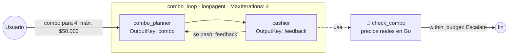
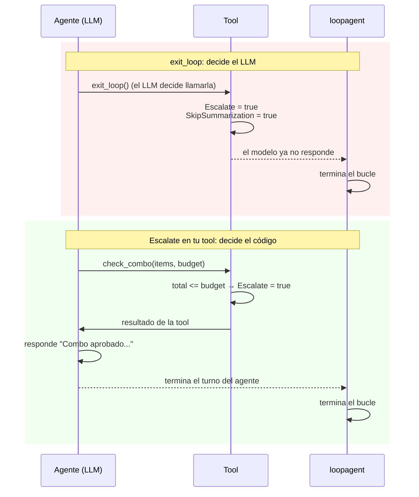
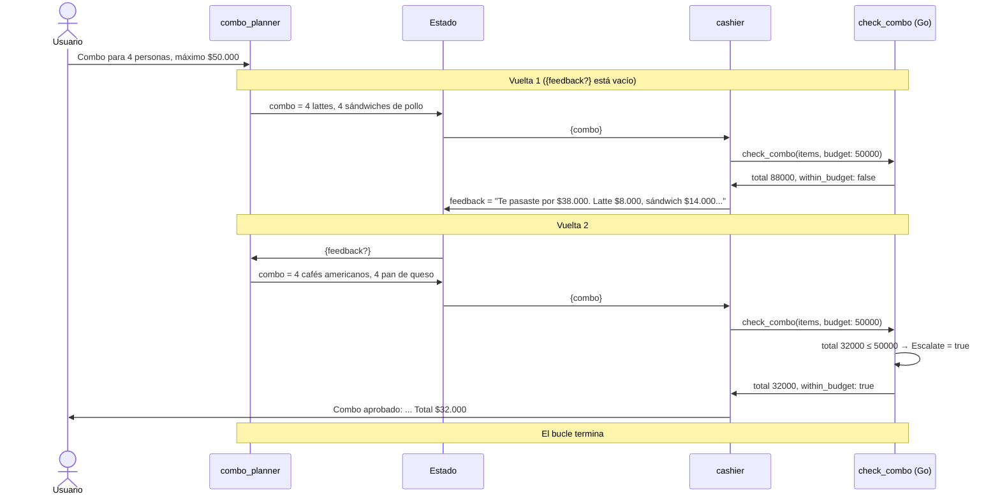

# my_workflow_loop — workflow en bucle

Un cliente pide un combo con presupuesto, por ejemplo "un combo para 4 personas con máximo $50.000". Dos agentes trabajan **en bucle** hasta que el combo cumple el presupuesto:

- `combo_planner`: arma el combo con los productos del menú. **No conoce los precios**; solo se entera por las correcciones del cajero.
- `cashier`: verifica el combo con la tool **`check_combo`**, una función Go con los precios reales. Si el combo cumple, la propia tool detiene el bucle. Si no, el cajero dice cuánto se pasó y cuánto cuesta cada producto.



## Cómo funciona `loopagent`

- Ejecuta sus `SubAgents` **en orden**, igual que un secuencial, y al terminar el último **vuelve a empezar** desde el primero.
- Se detiene por una de dos razones, la que ocurra primero:
  1. Algún evento trae **`Escalate = true`**. El `loopagent` termina cuando acaba el sub-agente que lo produjo (`agent/workflowagents/loopagent/agent.go`).
  2. Se llega a **`MaxIterations`**, el límite de seguridad para que el bucle no corra para siempre. Con `0`, no hay límite.

## La condición de salida la decide el código, no el LLM

Este es el punto más importante del ejemplo. La forma de verificar si "ya está bien" determina si el bucle sirve:

| Verificación | Ejemplo | Problema |
|---|---|---|
| Un LLM opina | "¿Esta descripción es buena?" | El LLM puede aprobar cualquier cosa, o el otro agente puede "hacer trampa" cumpliendo la forma sin el fondo |
| **El código calcula** | `total <= presupuesto` en `check_combo` | **Ninguno**: la condición es objetiva y no se puede engañar |

Por eso `check_combo` activa `Escalate` **ella misma** cuando el combo cumple el presupuesto:

```go
response.WithinBudget = response.Total <= req.Budget

if response.WithinBudget {
	ctx.Actions().Escalate = true
}
```

El LLM del cajero no decide si se sale del bucle: solo llama a la tool y reporta el resultado.

## `exit_loop` vs. `Escalate` desde tu propia tool

Las dos formas detienen el bucle con **el mismo mecanismo**: `Escalate = true`. De hecho, `exit_loop` es solo una function tool del ADK que activa ese flag (`tool/exitlooptool/tool.go`):

```go
// Lo que hace exit_loop por dentro
func exitLoop(ctx agent.Context, myArgs struct{}) (map[string]string, error) {
	ctx.Actions().Escalate = true
	ctx.Actions().SkipSummarization = true
	return map[string]string{}, nil
}
```

```go
// Lo que hace nuestra check_combo
if response.WithinBudget {
	ctx.Actions().Escalate = true
}
```

La diferencia está en **quién decide** y en **qué pasa después**:

| | `exit_loop` (`exitlooptool.New()`) | `Escalate` desde tu tool (`check_combo`) |
|---|---|---|
| ¿Quién decide salir? | **El LLM**, cuando cree que terminó y decide llamar a la tool | **Tu código**, con una condición objetiva (`total <= presupuesto`) |
| ¿Se puede equivocar? | Sí: puede aprobar algo que no cumple, o no llamarla nunca | No, si la condición está bien escrita |
| `SkipSummarization` | **Sí**: después de llamarla el modelo **ya no responde** | **No**: el modelo recibe el resultado de la tool y **responde** |
| ¿Qué ve el usuario al final? | Solo la llamada a `exit_loop`, sin mensaje | El mensaje del agente ("Combo aprobado... Total $32.000") |
| Código necesario | Ninguno: `exitlooptool.New()` y una línea en la instrucción | Una tool propia con la condición |
| Cuándo usarla | La condición es subjetiva y solo un LLM puede juzgarla: tono, claridad, estilo | La condición se puede **calcular**: presupuesto, validación, tests, formato |



> **Detalle importante:** `Escalate` no corta al agente en el acto. El `loopagent` revisa cada evento y, cuando ve `Escalate`, **espera a que termine el sub-agente actual** y luego sale (`agent/workflowagents/loopagent/agent.go`). Por eso el cajero alcanza a responder antes de que el bucle termine.

En este ejemplo usamos `Escalate` desde `check_combo` porque la condición se puede calcular y porque queremos que el usuario vea el combo aprobado. En el primer intento de este ejemplo usamos `exit_loop` con un editor que juzgaba una descripción, y el resultado mostró el problema: el LLM aprobó una "descripción" que solo repetía la lista de ingredientes.

## Cómo se pasan los datos entre vueltas: el estado

Los dos agentes se comunican por el estado de la sesión, igual que en [`my_workflow_sequential`](../my_workflow_sequential). La diferencia es que aquí los valores **se sobrescriben en cada vuelta**:

| Clave | La escribe | La lee | En cada vuelta |
|---|---|---|---|
| `combo` | `combo_planner` (`OutputKey`) | `cashier` (`{combo}`) | El nuevo combo reemplaza al anterior |
| `feedback` | `cashier` (`OutputKey`) | `combo_planner` (`{feedback?}`) | Las nuevas correcciones reemplazan a las anteriores |

El `?` de `{feedback?}` es clave: en la **primera vuelta** el cajero todavía no ha revisado nada y la clave no existe. Sin el `?`, el ADK daría error.



## El menú (`check_combo.go`)

Precios en pesos colombianos (COP):

| Producto | Precio | Producto | Precio |
|---|---|---|---|
| Café americano | $4.500 | Croissant | $5.000 |
| Capuchino | $7.000 | Pan de queso | $3.500 |
| Latte | $8.000 | Empanada | $3.000 |
| Chocolate caliente | $6.500 | Sándwich de pollo | $14.000 |
| Té | $4.000 | Torta de chocolate | $9.000 |
| Jugo de naranja | $6.000 | Galleta | $2.500 |

El `combo_planner` ve los nombres en su instrucción, pero los precios solo existen en `check_combo`. Si pide un producto que no está en el menú, la tool devuelve un error y el cajero se lo hace saber.

## Cuándo usar un workflow en bucle

Cuando un resultado se **mejora por intentos** hasta cumplir una condición, idealmente verificable con código: ajustar a un presupuesto, corregir hasta pasar una validación o unos tests, reintentar hasta obtener un formato válido.

| | Secuencial | Paralelo | Bucle |
|---|---|---|---|
| Orden | Uno tras otro, una vez | Todos a la vez | Uno tras otro, varias veces |
| Termina cuando | Pasa el último paso | Terminan todas las ramas | Algo activa `Escalate` o se llega a `MaxIterations` |
| Ejemplo | [`my_workflow_sequential`](../my_workflow_sequential) | [`my_workflow_parallel`](../my_workflow_parallel) | Este |

## El grafo de la UI

El generador de grafos dibuja el `loopagent` como un recuadro con una flecha de `combo_planner` a `cashier` y otra de vuelta, que representa la repetición. La tool `check_combo` aparece como nodo 🔧, aunque sin la línea que la une con el cajero: el generador no traza las líneas de las tools de agentes que están dentro de un recuadro.

## Prueba

```bash
export GOOGLE_API_KEY=...
go run . web api -include_debug_api webui
```

> Desde ADK v2.5.0, el grafo y las trazas de la UI necesitan `-include_debug_api`. La UI queda en http://localhost:8080/ui/.

1. "Un combo para 4 personas con máximo $50.000" → verás vueltas de combo → verificación hasta que el cajero responde "Combo aprobado" con el total.
2. "Un combo para 2 personas con máximo $12.000" → un presupuesto muy ajustado necesita más vueltas, o termina por `MaxIterations` sin aprobarse.
3. En la pestaña **State** verás cómo cambian `combo` y `feedback` en cada vuelta.
