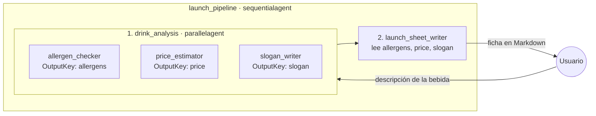
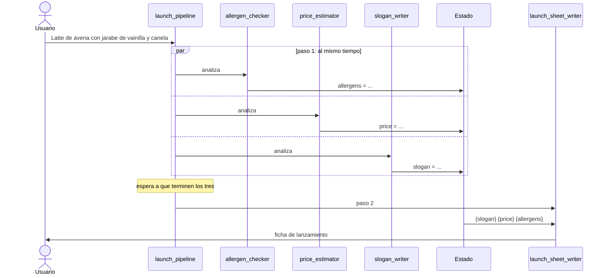

# my_workflow_parallel — workflow paralelo

La cafetería quiere lanzar una bebida nueva. Tres especialistas la analizan **al mismo tiempo**, porque ninguno necesita el resultado de otro, y al final un agente une todo en una ficha de lanzamiento.



## Cómo funciona `parallelagent`

- Ejecuta todos sus `SubAgents` **al mismo tiempo**, no uno tras otro.
- Cada rama trabaja **aislada**: mientras corre, no ve lo que hacen las otras.
- Cada especialista guarda su resultado en el estado con **su propio `OutputKey`**. Si dos usaran la misma clave, uno pisaría al otro.
- El `parallelagent` termina cuando terminan **todas** sus ramas.

## Abrir y unir: parallel dentro de un sequential

Un `parallelagent` solo no une los resultados. Para eso se mete **dentro de un `sequentialagent`**, seguido de un agente que lee todas las claves:

1. `drink_analysis` (parallel): los tres especialistas llenan `allergens`, `price` y `slogan`.
2. `launch_sheet_writer`: su instrucción tiene `{slogan}`, `{price}` y `{allergens}`, y el ADK los reemplaza con los valores del estado.

Es la primera vez que **anidamos workflows**: un workflow es un agente más, así que puede ser sub-agente de otro.



## Cuándo usar un workflow paralelo

Cuando hay **tareas independientes** sobre la misma entrada: ninguna necesita el resultado de otra. Se gana tiempo, porque el total tarda lo que tarda la rama más lenta y no la suma de todas.

| | Secuencial ([`my_workflow_sequential`](../my_workflow_sequential)) | Paralelo |
|---|---|---|
| Orden | Uno tras otro | Todos a la vez |
| ¿Un paso usa el resultado del anterior? | Sí (`{invoice_items}` → `{categories}`) | No, cada rama es independiente |
| Tiempo total | La suma de todos los pasos | Lo que tarda la rama más lenta |
| Para unir resultados | No hace falta, el último paso ya tiene todo | Un agente posterior, dentro de un secuencial |

## Qué se ve en la UI

- Las tres respuestas del paso 1 pueden llegar **en distinto orden** cada vez que lo ejecutes. Es la prueba visible de que corren en paralelo.
- En la pestaña **State** verás `allergens`, `price` y `slogan`.

### ⚠️ El grafo de la UI no se dibuja (bug del ADK Go)

Con un workflow anidado dentro de un `sequentialagent`, la pestaña del grafo queda vacía. Es un bug del generador de grafos del ADK Go (presente en v2.4.0 y v2.5.0), no de este código:

- El `parallelagent` se dibuja como un subgrafo llamado `cluster_drink_analysis`.
- Para unir los pasos del secuencial, el generador traza una flecha desde un nodo `drink_analysis`, que no existe, y toda la imagen falla con `drink_analysis is not a node or a subgraph`.
- Se puede comprobar en `http://localhost:8080/api/dev/apps/launch_pipeline/build_graph_image`.

El flujo funciona igual. Para la clase, usa el diagrama mermaid del inicio de este README.

## Prueba

```bash
export GOOGLE_API_KEY=...
go run . web api webui
```

1. "Latte de avena con jarabe de vainilla y canela" → tres análisis y luego la ficha completa.
2. Repite con "Frappé de chocolate con crema batida y maní" → observa si las tres respuestas llegan en otro orden.
