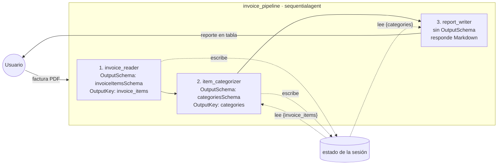
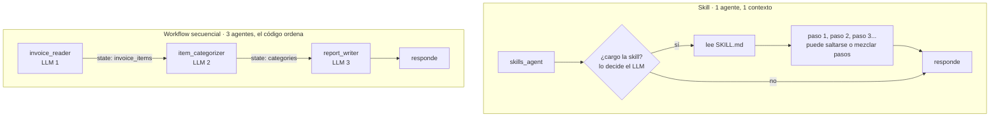
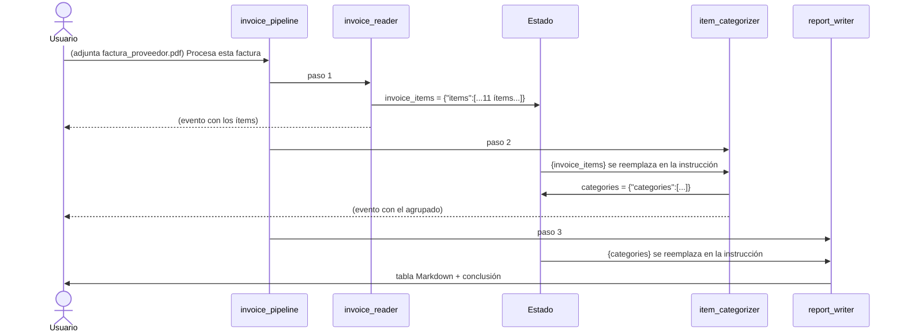

# my_workflow_sequential — workflow secuencial

Un pipeline que procesa la factura de un proveedor de la cafetería y **siempre** ejecuta tres agentes en el mismo orden:

1. `invoice_reader`: lee la factura adjunta (PDF o imagen), extrae sus ítems y los guarda en el estado con `OutputKey: "invoice_items"`.
2. `item_categorizer`: lee `{invoice_items}` desde su instrucción, agrupa los ítems por categoría, calcula los subtotales y guarda el resultado con `OutputKey: "categories"`.
3. `report_writer`: lee `{categories}` y presenta el reporte en Markdown (tabla y conclusión) para que lo lea una persona.



## Cuándo usar un workflow secuencial

Cuando el proceso **siempre es igual**: primero A, luego B, sin excepciones. Procesar una factura es un buen ejemplo, porque siempre hay que leerla, extraer los ítems y agruparlos. No hace falta que un LLM decida qué sigue.

En los ejemplos anteriores ([`my_multiagent_delegation`](../my_multiagent_delegation) y [`my_multiagent_modes`](../my_multiagent_modes)), el **LLM del coordinador** decidía a quién llamar y cuándo. Aquí no hay coordinador con LLM: `sequentialagent` es un agente sin modelo que **ejecuta sus `SubAgents` uno tras otro**, siempre en el orden en que están en la lista.

| | Delegación / modos | Workflow secuencial |
|---|---|---|
| ¿Quién decide el orden? | El LLM del coordinador | El código (el orden de `SubAgents`) |
| ¿Se puede saltar un paso? | Sí, si el LLM lo decide | No, siempre se ejecutan todos |
| Uso típico | Conversaciones abiertas | Procesos fijos: primero A, luego B |

## ¿Y la diferencia con una Skill?

Las dos dan instrucciones precisas. La diferencia está en **quién garantiza que se sigan**:

- **Skill** ([`my_agent_with_skills`](../my_agent_with_skills)): **un solo agente** lee las instrucciones y **el LLM decide** si las carga, cuándo y cómo seguirlas. Es como darle un manual a un empleado: confías en que lo lea y siga los pasos.
- **Workflow secuencial**: **varios agentes**, y **el código garantiza** el orden. Es como una línea de producción: cada estación hace una sola cosa y la pieza pasa a la siguiente sí o sí.



| | Skill | Workflow secuencial |
|---|---|---|
| ¿Cuántos agentes? | Uno | Uno por paso |
| ¿Quién decide si se ejecuta? | El LLM (puede no cargar la skill) | El código (siempre se ejecuta) |
| ¿Se puede saltar un paso? | Sí, si el LLM se confunde | No |
| Contexto | Todo en una conversación, que crece con cada paso | Cada agente se enfoca en su tarea y recibe solo lo que necesita por el estado |
| Validar la salida de cada paso | Difícil, todo sale en una respuesta | Cada paso tiene su `OutputSchema` |
| Distinto modelo por paso | No | Sí (p. ej., uno barato para extraer y otro mejor para el reporte) |
| Ver dónde falló | Hay que leer toda la respuesta | Cada paso es un evento separado en la UI |
| Cuándo se carga | Solo cuando el LLM la necesita, lo que ahorra tokens | Siempre corre completo |

**Cuándo usar cada una:**

- **Skill:** conocimiento o un procedimiento que el agente **podría** necesitar, **dentro de una conversación abierta**. Por ejemplo, "si te piden un reporte ejecutivo, sigue esta plantilla". El agente atiende muchas cosas y solo a veces usa la skill.
- **Workflow:** un proceso que **siempre** debe ejecutarse igual y completo, donde un error en un paso no puede pasar desapercibido. Procesar facturas es un buen caso: no quieres que el modelo "decida" saltarse la categorización.

**No son excluyentes.** Un paso de un workflow puede tener sus propias skills. Por ejemplo, `report_writer` podría usar la skill `reporte-ejecutivo` para dar formato a su reporte.

> En una frase: la skill le dice al agente **cómo** hacer algo si lo necesita; el workflow decide **qué** se hace y en qué orden, siempre.

## Cómo pasan los datos de un agente al otro: el estado

Los agentes del pipeline no se llaman entre sí. Se comunican por el **estado de la sesión**, el mismo que vimos en [`my_agent_with_sessions`](../my_agent_with_sessions):

- `invoice_reader` tiene `OutputKey: "invoice_items"`. Al terminar, el ADK guarda su respuesta en `state["invoice_items"]` como texto JSON.
- `item_categorizer` tiene `{invoice_items}` en su `Instruction`. Antes de llamar al modelo, el ADK reemplaza el placeholder con el valor del estado.



## Los esquemas (`invoice_schemas.go`)

Los pasos 1 y 2 tienen `OutputSchema`, así la salida de uno es una entrada predecible para el siguiente:

- `invoiceItemsSchema`: `{ items: [ {description, quantity, unit_price, total} ] }`
- `categoriesSchema`: `{ categories: [ {category, items: [...], subtotal} ] }`

`category` es un `enum` (`Café`, `Lácteos`, `Desechables`, `Limpieza`, `Otros`), así el modelo no inventa categorías nuevas.

### ¿Por qué el paso 3 no tiene `OutputSchema`?

El JSON sirve para pasar datos **entre agentes**, pero es difícil de leer para una persona. Por eso el último paso responde texto libre en Markdown. Es un patrón común: los pasos intermedios hablan en JSON y el último le habla al usuario.

## Factura de ejemplo

`factura_proveedor.pdf` es la factura de "Distribuidora El Grano" con 11 ítems mezclados. El reporte final esperado es aproximadamente este (el modelo decide categorías ambiguas, como el jarabe de vainilla):

| Categoría | Ítems | Subtotal |
|---|---|---|
| Café | café en grano, café descafeinado | 562.00 |
| Lácteos | leche entera, leche de avena, crema de leche | 282.00 |
| Desechables | vasos, tapas, servilletas | 185.00 |
| Limpieza | detergente, desinfectante | 105.00 |
| Otros | jarabe de vainilla | 64.00 |
| **Total** | | **1,198.00** |

## El grafo de la UI sí muestra flechas

El generador de grafos del ADK Go dibuja el `sequentialagent` como un recuadro y une con una línea cada paso con el siguiente: `invoice_reader → item_categorizer → report_writer`.

## Prueba

```bash
export GOOGLE_API_KEY=...
go run . web api webui
```

1. En la UI, adjunta `factura_proveedor.pdf` con el clip y escribe "Procesa esta factura".
2. Verás tres respuestas en orden: el JSON con los 11 ítems (`invoice_reader`), el JSON agrupado (`item_categorizer`) y la tabla final (`report_writer`).
3. En la pestaña **State** verás las claves `invoice_items` y `categories`.
